# 第3章 系统总线（图解学习笔记）

这篇笔记结合 [[课件/03.pptx|第三章课件]]（39 页）与唐朔飞《计算机组成原理》第二版第三章，按教材 **3.1–3.5** 的逻辑整理。先理解共享通路为什么出现，再看传什么、传多快、怎样连接，最后解决使用权与时间配合。

**页码约定**：“课件第 × 页”是幻灯片序号；“书页 ×”是教材印刷页码。你提供的 PDF 中，**PDF 页码 = 书页 + 11**，第三章在 PDF 第 52–78 页。标成“教学例”的内容用于解释机制；标准参数的差异在相应位置说明。

> [!abstract] 先抓住这一条主线
> **总线是各部件共享的信息通路。共享降低了连接与扩展的复杂度，也带来了争用，因此要规定：传什么、能传多快、怎样连接、谁先使用、双方如何配合。**
>
> **判优／仲裁**决定使用权，**通信控制**决定一次传输如何开始、推进和结束。总线控制包含这两个问题。

## 先看这里：学习路线与教材地图

第一次读，沿着 **3.1 的读内存例子 → 3.2 的三类信号 → 3.5 的判优与通信**，先把一次传输讲清楚。第二遍读 **3.3 的计算、3.4 的结构**。历史总线标准可以作为查阅材料，最后用“复习与练习”检查理解。


“单总线／多总线”讨论连接结构，“同步／异步”讨论时间配合；这两个分类角度彼此独立。

| 教材与本笔记 | 要回答的问题 | 教材书页（PDF 页） | 对应课件 |
| --- | --- | --- | --- |
| [[#3.1 总线的基本概念：从共享的原因到一次传输\|3.1 总线的基本概念]] | 为什么共享通路？一次读内存如何发生？ | 41–43（52–54） | 2–5、27 |
| [[#3.2 总线的分类：先找分类依据\|3.2 总线的分类]] | 连接哪里？地址、数据、控制各传什么？ | 43–45（54–56） | 6–7 |
| [[#3.3 总线特性及性能指标：先定规则，再算性能\|3.3 总线特性及性能指标]] | 接口怎样约定？宽度、地址范围、带宽怎样算？标准有什么用？ | 45–51（56–62） | 8–13 |
| [[#3.4 总线结构：为什么会出现多条通路\|3.4 总线结构]] | 单总线为什么遇到瓶颈？多总线与桥怎样改善？ | 52–57（63–68） | 3–5、14–22 |
| [[#3.5 总线控制：先分配使用权，再完成交换\|3.5 总线控制]] | 多个模块谁先用？获得使用权后怎样传？ | 57–66（68–77） | 23–39 |
| [[#复习与练习：讲清主线，再检查计算\|复习与练习]] | 能否解释图、算对速率、分清条件？ | 66–67（77–78） | 全章 |

> [!tip] 每节只抓一个问题
> 看分类时问“按什么分”；看结构时问“谁连接谁”；看仲裁时问“谁获准”；看时序时问“下一步由时钟还是应答决定”。把当前问题说清楚，比一开始记住所有名称更有用。

## 3.1 总线的基本概念：从共享的原因到一次传输

### 总线为什么存在

CPU 要取指令、读数据；主存要返回内容；I/O 设备也要和计算机交换信息。教材从连接方式的矛盾入手：早期以运算器为中心时，I/O 与主存交换数据也要经过运算器，容易影响计算；给部件分别布置专用连接，又会使连线和扩展越来越复杂（书页 41–42）。

总线提供一套共同使用的连接与传输规则。可以把它想成大家共用的一条通道：各部件接入通道，按规则发送地址、命令和数据。

**总线连接各部件，并提供大家共同使用的信息传输通路。** “共享”既是优势，也是后续仲裁与通信规则的原因。

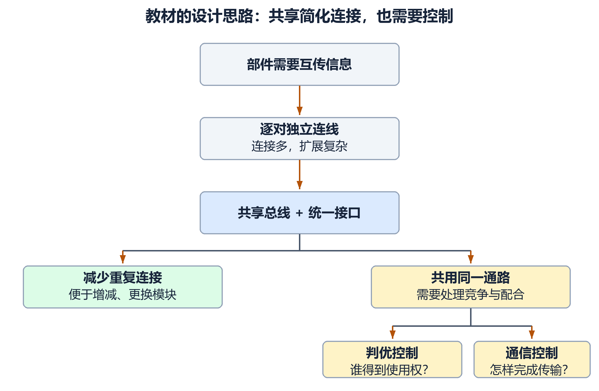

这张图把教材的出发点连起来：先减少重复连接，再解决共享带来的竞争。总线接口还让模块能够按统一规则接入，方便增减和更换部件。

> [!tip] “共享”是本章后半部分的起点
> 同一组共享数据线上，在同一时刻应由一个发送源驱动有效数据，避免互相冲突；**多个接收方可以同时接收同一份数据**。因此，“共享”不等于“多人同时发送”，也不等于“只能有一个接收方”。
>
> 想象寄存器 D 发送、A/B/C 同时装入：只让 D 的输出接通总线，同时允许 A/B/C 接收即可。教材习题 3.12(1) 正是在检验这个区别。

### 补充：没轮到的输出，怎样避免干扰总线

共享数据线常用 **三态输出**：除了输出 0、输出 1，还有高阻态 Z。没获准发送的模块关闭输出驱动，进入 Z；**Z 是不驱动这根线，不是发送逻辑 0**。双向接口则配合方向与输出使能控制，安排何时发送、何时接收。

连接部件还要尽量少增加输入负载，并有合适的输出驱动能力。这些电路知识帮助理解教材习题 3.1、3.11、3.12；本章先抓住“控制一个源发送，可以允许多个目的接收”。

### 一个贯穿全章的例子

假设 CPU 想读取主存地址 `0x1000` 处的一个数，那里存着 `42`。先忽略 Cache 等细节，只看本章的总线模型。

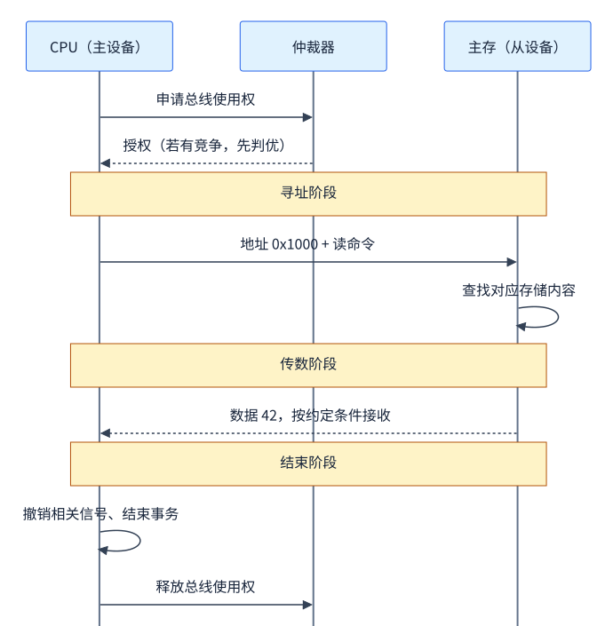

图中从上到下表示时间先后；回到同一模块的箭头表示它的内部操作。依次读这张图：

1. **申请与分配**：若还有其他模块竞争，CPU 先取得总线使用权。
2. **寻址**：CPU 给出地址 `0x1000`，并发出“读主存”命令。
3. **传数**：主存找到内容，把 `42` 放到数据总线上；CPU 按规定时刻接收。
4. **结束**：撤销有关信号，结束本次传输，释放总线。

这里已经出现全章最重要的三个信息：**地址告诉对方找哪里，控制命令告诉对方做什么，数据是实际要传的内容。**

### 主设备、从设备，和数据发送方

| 角色      | 含义             | 在这个读内存例子中 |
| ------- | -------------- | --------- |
| 主设备／主模块 | 获得总线控制权，发起本次传输 | CPU       |
| 从设备／从模块 | 响应主设备的地址和命令    | 主存        |
| 数据发送方   | 本次把数据放到数据线上的模块 | 主存        |
| 数据接收方   | 本次接收数据的模块      | CPU       |

> [!important] 主设备不等于数据发送方
> **读操作中，CPU 是主设备，主存却是数据发送方。** 判断主从，要看谁控制、发起这次事务，不能只看数据箭头。
>
> 补充：DMA 控制器等模块也可以成为总线主设备，因此“主设备永远是 CPU”也不成立。

### 教材开头三种连接方式，为什么逐步改变

对应书页 42–43、图 3.1–3.3。先理解各图解决什么问题，完整的总线结构放在 3.4。

| 方式 | I/O 与主存交换数据的路径 | 主要得失 |
| --- | --- | --- |
| 面向 CPU 的双总线（图 3.1） | I/O → CPU → 主存 | CPU 分别连接两条通路，但搬运仍要经过 CPU |
| 单总线（图 3.2） | 在总线控制规则下可由 I/O 接口直接与主存交换 | 减少 CPU 逐个搬运的工作，但大家竞争同一通路 |
| 以存储器为中心的双总线（图 3.3） | 保留公共系统通路，另设 CPU–主存的专用存储通路 | 改善 CPU 访问主存的通路；最终仍要考虑主存等共享资源 |

> [!note] “CPU 可以继续工作”的条件
> I/O 与主存直接传输时，CPU 可继续执行不需要被占用通路或主存资源的操作。它减少的是 CPU 搬运负担，不能据此认为 CPU 的任何访问都完全不受影响。

## 3.2 总线的分类：先找分类依据

对应书页 43–45、课件第 6–7 页。教材主要按 **连接部件的范围**分为片内、系统、通信三类；同一条总线还可以按串行／并行、宽度等角度描述，这些角度并不互斥。

### 3.2.1 片内总线：芯片内部

连接一个芯片内部的部件，例如 CPU 内部寄存器之间、寄存器与 ALU 之间的信息通路。它回答的是“芯片里面怎样交换信息”。

### 3.2.2 系统总线：CPU、主存与 I/O 接口之间

系统总线也可称板级／板间总线，是本章的主要对象。按 **传输内容**分为数据、地址、控制三组信号。


这张图以 **带确认应答的 CPU 读主存** 为例。地址和读命令由 CPU 发出，数据和确认由主存返回。

| 类别 | 传什么 | 本例 | 方向的理解 |
| --- | --- | --- | --- |
| 数据总线 | 实际数据或指令内容 | `42` | 整体上双向：读与写时方向不同 |
| 地址总线 | 要访问的主存单元或 I/O 地址 | `0x1000` | 课件的传统模型为单向，由当前主模块送出地址 |
| 控制总线 | 命令、请求、确认、状态等 | 读、写、总线请求、中断请求 | 各根线职责不同，有的向外，有的向内 |

**地址线是“编号”，数据线是“内容”。** 地址线更多，通常意味着可区分的地址更多；数据线更多，意味着一次并行传输可以携带更多位。

> [!note] 控制总线“有出有入”怎样理解
> 这是对一组控制线整体而言的描述，不表示每一根控制线都双向传输。例如读命令由主设备发出，确认信号由从设备返回。

#### 控制信号不要混成一类

书页 44 列出的控制信号可按任务理解：

| 任务 | 典型信号 | 它解决什么问题 |
| --- | --- | --- |
| 使用权分配 | 总线请求 BR、总线同意 BG、总线忙 BS | 谁可以占用共享通路？ |
| 传输操作与配合 | 存储器读／写、I/O 读／写、传输确认 | 访问哪类对象、做什么、是否完成？ |
| 事件处理 | 中断请求、中断响应 | 是否有事件需要 CPU 处理？ |
| 基本协调 | 时钟、复位 | 如何统一时刻、回到初始状态？ |

**BG 是授予总线使用权；传输确认 ACK 是对一次交换的回应。中断请求也不等于总线请求。** 名字里都有“请求”，任务却不同。

### 3.2.3 通信总线：与外部系统通信

连接计算机系统之间，或计算机与其他系统之间的通信接口。教材用串行与并行说明通信总线的传送方式；这个分类角度也能用于描述其他总线。

| 传输方式 | 一次怎样传位 | 直观例子 |
| --- | --- | --- |
| 串行 | 在一条串行数据通道上，数据位依次传送 | `1`、`0`、`1`、`1` 先后通过 |
| 并行 | 在多条数据线上，同时传送多位 | 4 条线上同一时刻送出 `1011` |

补充：“串行”不等于整个接口只有一根导线，接口还可能需要差分线、地线和其他信号线。比较速度时还要看传输频率与协议，不能只用“串行／并行”下结论。

在教材的传统比较中，串行所需连线少，适合较长距离；并行用多条线同时传位，适合较近距离。距离、连线成本、信号时序和具体接口条件要一起考虑。串行帧与速率的具体例子见 3.5.2。

## 3.3 总线特性及性能指标：先定规则，再算性能

对应书页 **45–51**、课件第 **8–13 页**。教材依次讲四种特性、性能指标、总线标准：只有接口规则一致，性能参数才有比较和计算的意义。

### 3.3.1 总线特性：接口怎样约定

总线的物理实现可以是主板上的导线、连接插板的接口等。要让不同模块正确连接，必须有共同规定。

| 特性 | 规定什么 | 记忆问题 |
| --- | --- | --- |
| 机械特性 | 尺寸、形状、管脚数、排列顺序 | 接口能否接上？ |
| 电气特性 | 传输方向、有效电平范围等 | 什么电平算有效信号？ |
| 功能特性 | 每根传输线的用途 | 这根线传地址还是数据？ |
| 时间特性 | 各信号的先后顺序与时序关系 | 何时发命令、何时取数据？ |

**功能特性说“这根线做什么”，时间特性说“它何时有效”。** 电气特性还决定什么电平代表逻辑状态，因此逻辑 1、信号有效、高电平不是天然相同的概念。后面的低有效读信号和 WAIT 就会用到这个区别。

### 3.3.2 总线性能指标：分清位数、次数与时间

#### 数据线决定宽度，地址线决定地址数量

**总线宽度**通常指数据总线的位数。32 位数据总线，在一次完整的并行数据传输中可以传送：

$$
32\ \text{bit}=4\ \text{B}
$$

若有 $a$ 根地址线，则最多能区分的地址数为：

$$
N_{\text{地址}}=2^a
$$

要从地址数换算成存储容量，还要知道 **每个地址对应多少字节**：

$$
\text{可寻址容量}=2^a\times\text{每个地址单元的字节数}
$$

**例：24 根地址线。**

- 按字节编址：$2^{24}$ 个字节，等于 **16 MiB**。
- 若按 32 位字编址，每个地址对应 4 B：容量为 $2^{24}\times4$ B，等于 **64 MiB**。

> [!warning] 不要把 32 位数据总线直接写成“能寻址 4 GB”
> 数据总线的 32 位描述一次传多少数据；地址范围要看地址位数和编址单位。这两种位数回答不同问题。

#### 数据总线宽度与机器字长、指令字长

它们描述不同对象：机器字长描述机器处理数据的基本位数；指令字长描述一条指令的长度；数据总线宽度描述一次并行能传多少位。三者可以不同，不能由其中一个直接推断另外两个。

教材书页 43 的例子：**数据总线 8 位、指令 16 位，读取这条指令至少需要两次数据传送**。在教材简化模型中，也就是至少两次访存。若每次都能完整取得 $W$ 位，且不考虑跨边界等额外开销，搬运 $L$ 位至少需要：

$$
N_{\text{传送}}=\left\lceil\frac{L}{W}\right\rceil
$$

例：64 位数据经 16 位总线传送，至少 4 次。这里的次数并不能直接告诉你用了几个时钟，还要看每次传输的协议。

#### 带宽最可靠的计算式

**带宽／传输率**表示单位时间传输的数据量。本章计算可以从下面这条式子出发：

$$
B=\frac{\text{每次传输的字节数}}{\text{一次传输所用时间}}
$$

设数据总线宽度为 $W$ 位，每秒完成 $r$ 次数据传输，则：

$$
B=\frac{W}{8}\times r\quad(\text{B/s})
$$

若时钟频率为 $f$，并且题目明确每个时钟传输 $k$ 次完整数据，则峰值为：

$$
B_{\text{峰值}}=\frac{W}{8}\times f\times k
$$

若一份数据必须用 $c$ 个时钟才能完成，且这些传输不能重叠，则：

$$
B=\frac{W}{8}\times\frac{f}{c}
$$

> [!important] 先找“多久传一份数据”
> 时钟频率不一定等于数据传输次数。地址、命令、等待等步骤也可能消耗时钟，不能看到 MHz 就直接乘数据宽度。

**三个对比例题：32 位总线，50 MHz。**

| 条件 | 计算 | 结果 |
| --- | --- | --- |
| 每个时钟传一份 32 位数据 | $4\times50\times10^6$ | 200 MB/s |
| 每个时钟传两份 32 位数据 | $4\times50\times10^6\times2$ | 400 MB/s |
| 每 4 个时钟完成一份 32 位数据，不能重叠 | $4\times50\times10^6/4$ | 50 MB/s |

这三种答案都可能正确，区别在题目给出的传输条件。

**教材例 3.1（书页 61）：100 MHz、32 位、一次传输 4 个时钟。**

$$
T=10\ \text{ns},\qquad t_{\text{传输}}=4T=40\ \text{ns}
$$

$$
B=\frac{4\ \text{B}}{40\ \text{ns}}=100\ \text{MB/s}
$$

想提高一倍，在其余条件保持不变时，可把数据宽度增至 64 位，或把时钟增至 200 MHz。若协议允许缩短每份数据占用的时钟数，也能提高速率，但这不是仅改一个数字就一定能实现的条件。

#### 单位最容易错在哪里

| 单位 | 含义 |
| --- | --- |
| bit，常写小写 `b` | 位 |
| B，常写大写 `B` | 字节，1 B = 8 bit |
| Mb/s 或 Mbps | 每秒百万位 |
| MB/s 或 MBps | 每秒百万字节 |
| MiB | $2^{20}$ B；与 $10^6$ B 的 MB 不同 |

例如：

$$
480\ \text{Mb/s}\div8=60\ \text{MB/s}
$$

这是按位数换算的理论数值。实际有效数据吞吐率还会受到协议开销、仲裁、等待等因素影响。

#### 其他指标与总线复用

| 指标 | 理解 |
| --- | --- |
| 信号线数 | 地址、数据、控制等信号线的数量；复用时要留意是否在问实际物理线数 |
| 同步／异步 | 双方按照公共时钟配合，还是按照请求与应答配合 |
| 控制方式 | 集中式由仲裁器分配使用权；分布式由各模块的逻辑共同决定 |
| 负载能力 | 总线可以支持的电气负载，影响能够连接的模块 |

**总线复用**：同一组物理线，在不同时间承担不同用途。例如先送地址，再送数据。

| 时间阶段 | 同一组线上的内容 |
| --- | --- |
| 地址阶段 | `0x1000` |
| 数据阶段 | `42` |

复用可以减少引脚和布线，但需要区分阶段、保存地址等控制逻辑，还可能增加传输时间。**复用按时间分阶段，不表示地址和数据在同一时刻混在一起。**

负载能力不只是“插槽有几个”：连接模块后仍需保证电平和时序满足要求。教材书页 57 用多层 PCI 与桥分隔总线段，说明设备增多时要考虑总线的驱动能力。

#### 突发传输：连续数据省掉重复的地址开销

教材书页 48–49 在 EISA、PCI 的介绍中讲“突发传输”。它抓住 **地址连续**这一条件：先给出起始地址，之后连续传送多份数据，避免为每一份数据重复送地址。

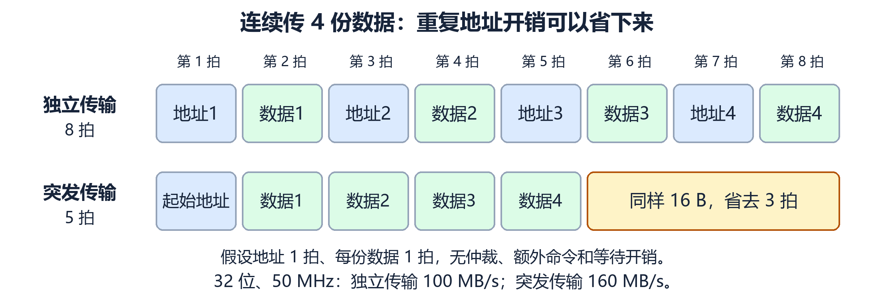

**教学例**：32 位、50 MHz，连续传 4 份数据，每份 4 B。假设地址阶段 1 拍、每份数据 1 拍；不计额外命令、仲裁、等待，不重叠。

| 传送组织 | 总时钟数 | 16 B 所用时间 | 本次平均速率 |
| --- | --- | --- | --- |
| 4 次独立传输，每次重新送地址 | $4\times(1+1)=8$ 拍 | 160 ns | 100 MB/s |
| 一次突发，先送地址再连续送数据 | $1+4=5$ 拍 | 100 ns | 160 MB/s |

在这组假设下，连续传 $n$ 份数据的速率为：

$$
B_n=\frac{n(W/8)}{(n+1)/f}=\frac{W}{8}f\frac{n}{n+1}
$$

$n$ 越大，地址开销占比越小，越接近每拍传一份数据的 200 MB/s 峰值。**突发提升来自摊薄开销，不是把物理时钟直接变快。**

> [!note] 三个“省”要分清
> **复用**省物理引脚与连线；**突发**省连续数据的重复地址等开销；**分离式**利用内部准备期间的总线时间。它们回答不同问题。

### 3.3.3 总线标准：共同规则带来互换与扩展

对应书页 **47–51**、课件第 **12–13 页**。总线标准把接口的特性和规则约定下来，使主模块、从模块、接口硬件和软件可以据此设计，方便互换、扩展和维护。

教材说接口具有“透明性”：一方按标准工作，不必了解对方内部如何实现。**即插即用**则强调系统能识别设备并配置资源；它不等于所有设备都不需要驱动。

下面是教材所处时代的例子，先记设计特点。具体数值必须连着宽度、时钟、每拍传输次数和所处版本一起读。

| 名称 | 在课件中的定位 | 先记住什么 |
| --- | --- | --- |
| ISA、EISA | 历史系统／扩展总线标准 | 与传统微型机结构相联系 |
| VESA／VL-BUS | 历史局部总线 | 与局部总线结构相联系；课件第 12 页的 LV-BUS 应结合后文 VL-BUS 理解 |
| PCI | 历史并行总线 | 可通过桥组织总线层次 |
| AGP | 图形相关的历史接口／总线 | 面向图形数据传输 |
| RS-232 | 串行通信接口标准 | 课件举的是终端设备与通信设备之间的接口 |
| USB | 串行接口／总线标准 | 速率通常以 Mb/s 表示，先分清位与字节 |

#### 用公式理解 PCI 的数字

课件使用 32 位、33 MHz，则在每时钟传一次完整数据的峰值条件下：

$$
\frac{32}{8}\times33\times10^6=132\ \text{MB/s}
$$

资料常写约 133 MB/s，是采用约 33.33 MHz 的时钟值。做题时应按题目给出的频率计算。

**核对：课件第 13 页将一档 PCI 写成“64 位、64 MHz、528 MB/s”。** 直接按这两个参数计算应为 512 MB/s，不能得到 528 MB/s；528 对应把频率取为 66 MHz。PCI-SIG 介绍传统 PCI 的扩展为 64 位和 66 MHz，因此这里的“64 MHz”与表中带宽不一致，可能是笔误。不要把这三个数一起死记。参见 [PCI-SIG 官方说明](https://pcisig.com/how-are-pci-x-versions-10-and-20-related-pci-are-they-same)。

教材书页 **48** 给出 PCI 的 64 位、66 MHz、528 MB/s 示例，与上面的计算一致。同页正文按 32 位、33 MHz 算得 132 MB/s；表中约 133 MB/s 的写法要理解频率取值的近似。

同页课件 ISA 的“16 位、8 MHz、33 MBps”也不能由每拍一次传输推出；VL-BUS 的“32 位、32 MHz、133 MBps”也不一致。教材本身也存在需要留意的数值：书页 47 表 3.1 与书页 48 正文对 VESA 所列频率、带宽档位不同，ISA 的表格与正文带宽数也不完全一致。**查标准要保留版本和传输条件；做计算题按题目条件推导。**

#### 教材这些标准，各自解决了什么问题

| 标准 | 理解重点（书页 47–51） |
| --- | --- |
| ISA → EISA | 在兼容早期接口的基础上增加宽度与能力；EISA 的例子还引出多主设备和突发传输 |
| VL-BUS | 让高速 I/O 靠近 CPU 的局部通路，但与当时处理器的总线联系紧密 |
| PCI | 通过桥减小与特定 CPU 的耦合；支持多主设备、突发传输、地址／数据复用和资源配置 |
| AGP | 面向图形；教材的双沿传送例子说明“一拍可以传两次”，不能把有效传送率当作物理时钟频率 |
| RS-232 | 终端设备 DTE（如计算机）与通信设备 DCE（如调制解调器）的串行接口标准，包含电气与信号规定 |
| USB | 通过主机、集线器、设备组成连接层次；串行数据传送仍需要相应的数据与供电等导线 |

**PCI 支持“多主设备”是允许多个模块申请使用权，不是多个主设备同时向同一组共享数据线送不同数据。** 桥分隔后的不同总线段，才提供更独立的工作空间。

**AGP 的教材例子**：物理时钟约 66.7 MHz，若上升沿和下降沿各传一份 32 位数据，峰值约为 $4\times66.7\times2=533.6$ MB/s。时钟仍是约 66.7 MHz，传送次数约 133.4 M 次/s。

#### USB：速率名称与单位

课件涉及的低速、全速、高速档分别为 **1.5、12、480 Mb/s**。USB-IF 官方 FAQ 也说明高速档为 480 Mb/s，参见 [USB-IF 速率说明](https://www.usb.org/node/214)。

只做单位换算时：

| 速率 | 除以 8 后 |
| --- | --- |
| 1.5 Mb/s | 0.1875 MB/s |
| 12 Mb/s | 1.5 MB/s |
| 480 Mb/s | 60 MB/s |

这些是位率到字节率的换算，并不保证应用能达到相同的有效数据吞吐率。USB 2.0 的规范入口见 [USB-IF 规范](https://www.usb.org/document-library/usb-20-specification)。

## 3.4 总线结构：为什么会出现多条通路

对应书页 **52–57**、课件第 **3–5、14–22 页**。教材的思路是：共享提高连接灵活性，但一条通路也会成为瓶颈，因此按任务、速度和负载组织多条通路。

### 3.4.1 单总线结构


CPU、主存和 I/O 接口接在同一套系统总线上，外设通过 I/O 接口接入。

优点是结构简单、连接与扩展方便。问题是大家竞争同一通路，某次传输占用它时，其他需要这条通路的传输通常要等待。

> [!important] “单总线”不表示只有一根线
> 一套系统总线可以包含地址线、数据线、控制线。“单总线”数的是结构中的总线通路／总线组，不是导线根数。

### 3.4.2 多总线结构：按任务和速度分工

CPU 与主存的访问、高速外设的大量数据传送、慢速设备的控制通信，需求不一样。课件的多总线结构把这些通路分开，并用接口、通道或桥连接。


这是参照课件第 18 页、教材图 3.10（书页 54）重画的 **四总线示意**：局部总线、系统总线、高速总线、扩展总线分别承担不同连接任务。图中“桥”负责连接不同总线段；具体结构和连接方式以相应课件图为准。

“桥”是不同总线段之间的协调接口，承担转接、缓冲等工作。两段总线可以有不同速度或信号规则，设备也可以通过桥跨段通信；分段还帮助分隔电气负载。桥提供协调能力，也有自身吞吐与延迟限制。

#### 同样叫“双／三总线”，拓扑也可能不同

| 课件结构 | 怎样理解 | 页码 |
| --- | --- | --- |
| 面向 CPU 的双总线 | CPU 分别连接主存通路和 I/O 通路 | 3 |
| 以存储器为中心的双总线 | 增加 CPU 与主存的专用存储总线，配合公共系统总线 | 5 |
| 带通道的双总线 | 主存总线与 I/O 总线分开，通道统一管理 I/O | 15 |
| 含 DMA 总线的三总线 | 主存总线、I/O 总线、DMA 总线承担不同传输任务 | 16 |
| 三总线的另一种形式 | 局部总线、系统总线、扩展总线形成分层 | 17 |
| 四总线结构 | 在分层结构中设置高速总线，连接高速外设 | 18 |
| 多层 PCI 总线 | 通过多级桥连接多个 PCI 总线段 | 22 |

**双总线、三总线首先描述总线数量；相同数量也可能对应不同拓扑。** 看结构题时，要看“连接了谁、谁通过什么访问谁”，不能只记名称。

> [!note] 补充：通道与 DMA
> **通道**是一种具有专门 I/O 管理功能的处理部件，负责组织 I/O 操作，减轻 CPU 的管理负担。
>
> **DMA** 是直接存储器访问：由 DMA 控制器等模块组织主存与外设的数据传送，避免让 CPU 对每个数据都执行一次搬运。DMA 仍然需要遵守相关总线的使用与传输规则。

#### 专门看清教材图 3.8：DMA 三总线

书页 **53** 的三总线分别服务 CPU–主存、CPU–I/O、高速 I/O–主存。它把数据搬运任务分出来，DMA 使高速设备与主存之间的传输不必由 CPU 逐份搬运。

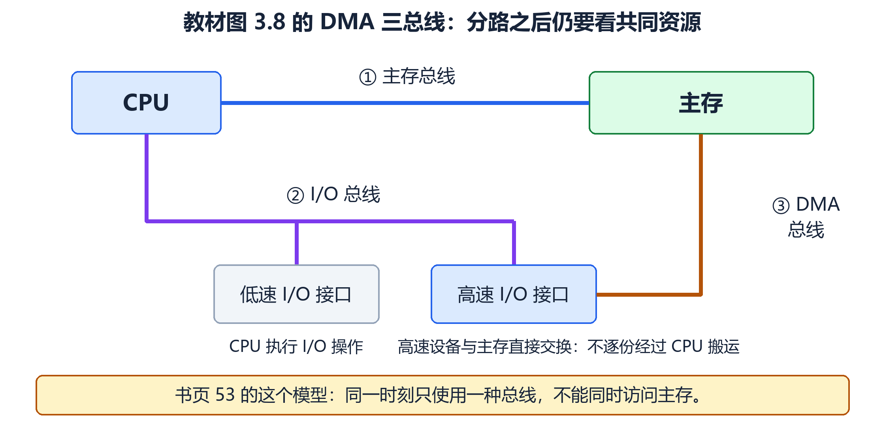

沿三条通路看图：

1. **主存总线**：CPU 与主存交换信息。
2. **I/O 总线**：CPU 通过接口执行 I/O 操作。
3. **DMA 总线**：高速 I/O 与主存直接交换数据。

> [!important] 三条总线不保证三件事同时进行
> 教材对 **图 3.8 这一具体模型**规定：同一时刻只使用一种总线；主存总线和 DMA 总线不能同时访问主存，I/O 总线只在 CPU 执行 I/O 指令时使用。因此，画出了三条通路，并不等于所有访问已经没有冲突。
>
> 看另一种三总线（图 3.9，书页 54）时，连接对象又变成局部、系统、扩展三个层次。**先看拓扑和共同资源，再判断能否并行，不能把图 3.8 的限制套给所有多总线系统。**

带通道的双总线（图 3.7，书页 53）则把 I/O 管理交给通道，分别组织主存总线和 I/O 总线。通道负责的管理能力与 DMA 的直接搬运机制，不能只按“几条线”理解。

### 3.4.3 总线结构举例：传统 → VL-BUS → PCI

课件第 **19–22 页**的结构图，可以沿着这个问题看：**高速外设怎样获得更合适的数据通路？**

| 结构 | 图中的主要变化 |
| --- | --- |
| 传统微型机结构 | 外设通过标准总线及控制器接入，高速外设也受这条通路约束 |
| VL-BUS 局部总线 | 给高速外设增加靠近 CPU 的路径，但与当时 CPU 总线耦合较紧 |
| PCI 结构 | 通过桥衔接 CPU 与 PCI，减少对特定 CPU 的依赖；慢设备另接较慢总线 |
| 多层 PCI | 用桥增加层次并分隔电气负载，解决单段连接设备增多后的驱动能力问题 |

先理解通路分工，再识别各个外设名称。多条总线提供更多组织传输的机会，但实际性能仍取决于桥、存储器等共同资源及协议。

这段演变分别处理三种限制：**传统总线的速率瓶颈 → VL-BUS 的处理器耦合 → 单段 PCI 的负载能力**。教材图 3.11–3.14（书页 55–57）可以按这条线索阅读。

## 3.5 总线控制：先分配使用权，再完成交换

共享通路带来两个独立的协调任务：**判优控制**选择哪个申请者获得使用权，**通信控制**安排主、从模块如何传送。这是教材从“总线结构”过渡到“总线控制”的原因。

### 3.5.1 总线判优控制：多个模块都想用，先给谁

对应书页 **57–59**、课件第 **23–26 页**。

**总线判优／仲裁决定使用权。** 获得使用权之后，还要通过 3.5.2 的通信规则完成传输。一个系统若有多个可能发起传输的主模块，就要处理它们同时申请的情况。

教材先分为集中式和分布式：前者把判优逻辑放在一个控制部件中，后者分散在各模块。图 3.15（书页 58）重点比较集中式的三种方法。

#### 先认清三个信号

| 信号 | 英文含义 | 中文含义 | 直观说法 |
| --- | --- | --- | --- |
| BR | Bus Request | 总线请求 | 我想使用总线 |
| BG | Bus Grant | 总线同意／授权 | 允许你使用总线 |
| BS | Bus Busy | 总线忙 | 总线正在被占用 |

这些是逻辑含义，是否高电平有效要看具体电路。**BG 是授权；从设备的 ACK 是传输应答，两者不能混用。**

#### 链式查询：授权沿着队伍传下去


图中的例子：设备 0 没申请，设备 1 和设备 2 同时申请。

1. 申请者通过公共 BR 发出请求。
2. 总线空闲时，控制器发出 BG。
3. BG 先到设备 0。设备 0 不申请，于是继续传递。
4. BG 到设备 1。设备 1 正在申请，于是截获授权、占用总线，BG 不再向后传给设备 2。

**优先级由链上的位置决定：离授权源越近，优先级越高。**

- 优点：仲裁控制线少，结构简单，增加设备较方便。
- 局限：固定优先级可能让后面的设备长期等待；授权链路出现故障可能影响后续设备；经过多个模块会产生传播延迟。

#### 计数器定时查询：报到你的编号，就轮到你


控制器收到 BR 后，在总线空闲时，通过计数器依次输出 **设备编号**。模块比较编号：如果编号等于自己，并且自己提出了申请，就取得使用权，并通过 BS 表示总线忙。

例：设备 0、1 未申请，设备 2、3 申请。若从 0 开始查询，就按 `0 → 1 → 2` 找到设备 2，随后停止本轮查询。

> [!important] 这里的“设备地址”是仲裁用编号
> 它用来选择申请总线的模块；不要和 CPU 读主存时发出的地址 `0x1000` 混为一谈。

优先级取决于计数起点和策略：

- 每轮从 0 开始：较小编号通常优先。
- 从上次服务设备的下一编号开始并循环：形成轮转，改善公平性。
- 通过改变初值：可以调整查询顺序。

它比链式方式需要更多仲裁线，但减少了对串接授权链的依赖。找到申请者仍需要查询时间。

#### 独立请求：每个人都有自己的请求线


每个设备有自己的 `BR_i` 和 `BG_i`。控制器看到各路请求后，用内部的优先级／排队逻辑直接选出一个申请者，并通过对应的授权线回应。

图中设备 1 与设备 2 申请，控制器根据本例设定的优先规则把授权交给设备 1。**独立请求并不强制某一种优先顺序，顺序由仲裁逻辑决定。**

- 优点：可以直接判优，响应快，优先级策略灵活。
- 局限：请求与授权线较多，控制器逻辑较复杂。

#### 三种方式一起比较

设申请设备数为 $N$，下面只统计 **仲裁信号**，不包含数据线和地址线。

| 比较项 | 链式查询 | 计数器定时查询 | 独立请求 |
| --- | --- | --- | --- |
| 怎样选择申请者 | BG 沿链传递，申请者截获 | 逐个广播设备编号 | 分别接收请求，直接判优 |
| 主要优先级依据 | 链中的物理位置 | 起始编号与查询策略 | 控制器内部逻辑 |
| 常见线数口径 | BR、BG、BS 共 3 类 | BR、BS 加 $\lceil\log_2N\rceil$ 根编号线 | $N$ 根请求线加 $N$ 根授权线；若另计公共 BS，再加 1 |
| 主要优点 | 简单、线少 | 可改变查询顺序 | 判优快、策略灵活 |
| 主要代价 | 链路依赖，低优先级可能饥饿 | 编号线与逐次查询时间 | 线多，仲裁器复杂 |

例：8 个设备的计数器方式，需要 $\lceil\log_2 8\rceil=3$ 根编号线。按表中口径，仲裁线合计为 $3+2=5$ 根。

> [!example] 线数题先统一统计口径（对应书页 59）
> 教材正文比较的是决定使用权的主要线数：链式用 BR/BG 共 2 根；计数器还要共享请求线与编号线；独立请求是 $2N$ 根。图中的公共 BS 是否计入总数，要看题目。
>
> 若 **10 个设备，并计 BR、BS**：计数器需 $\lceil\log_2 10\rceil=4$ 根编号线，总数是 $4+2=6$。不能把 $\log_2 10$ 的非整数值直接当作导线根数。

### 3.5.2 总线通信控制：拿到总线以后怎样把事情做完

对应书页 **59–66**、课件第 **27–39 页**。判优处理竞争，通信控制则规定开始、结束以及双方的配合方式。

#### 三种“周期”不要混淆

| 名称 | 含义 |
| --- | --- |
| 时钟周期 $T$ | 时钟重复一次的时间，$T=1/f$ |
| 总线传输周期 | 按总线规则完成一次传输所需的过程，可能包含多个时钟周期 |
| 一次 CPU 指令的执行过程 | 可能涉及取指、读写数据等多次访问；与一次总线传输不是一一对应 |

教材书页 59 把一次总线操作分为 **申请分配、寻址、传数、结束**。前面的读内存例子恰好对应这四步。具体协议可能合并阶段；只有一个主模块的简单系统，也可省去竞争性的申请分配过程。总线周期通常与时钟周期不同。

#### 同步通信：按共同的时钟表办事

双方使用统一的时钟，按预先约定的时刻发出和接收信号。

结合教材图 **3.16–3.17（书页 60–61）**和课件第 **29–30 页**，可按四拍理解：

| 阶段 | 读操作：CPU 接收数据 | 写操作：CPU 发送数据 |
| --- | --- | --- |
| T1 | CPU 给出地址 | CPU 给出地址 |
| T2 | CPU 发出读命令，主存／输入设备准备数据 | CPU 发出写命令；待写数据已提前准备 |
| T3 | 从模块在 T3 上升沿到来前提供有效数据，CPU 在规定时间内接收 | 从模块按协议在规定时间内接收已有效的数据 |
| T4 | 撤销相关信号，结束 | 撤销相关信号，结束 |

教材写操作还标出 **T1.5**：主模块在 T1 送地址之后、T2 发写命令之前先提供数据。读要等对方返回；写要先把自己要交给对方的内容准备好。T1–T4 是这些教学图的划分，不能把它当成所有总线固定遵循的模板。

**理解关键：双方知道应该在哪个时刻做事。** 如果约定 CPU 在某个边沿读取数据，主存必须在这个边沿之前把数据准备好，并保持足够时间。

- 好处：时间关系明确，控制较简单。
- 限制：规定的时间必须照顾设备延迟。纯固定周期方式中，较慢设备容易成为约束，较快设备也可能需要等到规定时刻。教材因此把它用于总线较短、各部件速度较接近的场景（书页 61）。

#### 异步通信：准备好了就应答

异步通信没有用于协调本次传输的公共时钟标准，通过请求、回答信号来推进动作。设备内部仍可以有自己的时钟。

先理解最完整的 **全互锁** 握手：

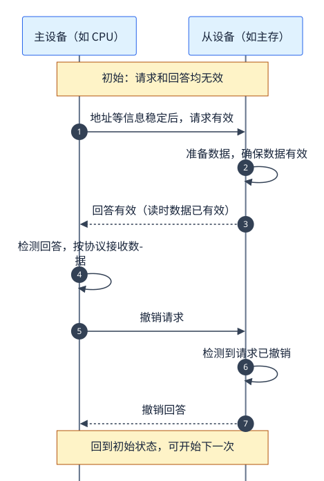

图中“发出／撤销”描述逻辑状态，不预设高电平还是低电平有效。

1. 主设备准备好地址等信息，发出请求。
2. 从设备完成相应准备，发出回答；读操作中，应先保证返回数据有效。
3. 主设备收到回答、完成规定的数据接收后，撤销请求。
4. 从设备检测到请求已经撤销，再撤销回答，回到初始状态。

**全互锁的顺序：请求有效 → 回答有效 → 请求撤销 → 回答撤销。** 每一步根据对方的状态推进，而不是只等一个估计时间。

##### 不互锁、半互锁、全互锁，差别在撤销信号的条件

对应教材图 **3.18（书页 62）**。

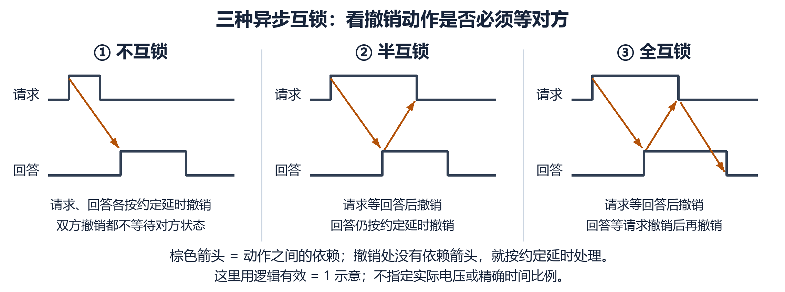

横轴为时间。箭头表示‘看到对方的这个变化，才继续’，不表示固定延迟；三个小图都用逻辑有效=1 作示意。

| 方式 | 主设备何时撤销请求 | 从设备何时撤销回答 |
| --- | --- | --- |
| 不互锁 | 发出后经过预定时间就撤销，不等待回答 | 发出后经过预定时间就撤销，不等待请求撤销 |
| 半互锁 | **收到回答后**才撤销请求 | 经过预定时间撤销回答，不等待请求撤销 |
| 全互锁 | **收到回答后**才撤销请求 | **检测到请求撤销后**才撤销回答 |

可以按“哪几步一定等对方”来记：不互锁不在撤销条件中互等，半互锁只有一侧等待对方状态，全互锁两侧都等待对方状态。

> [!warning] “半互锁”与“半同步”是两回事
> 半互锁描述异步请求与回答的依赖关系；半同步描述“公共时钟 + 等待信号”的通信方式。

##### 看懂课件原图：异步读周期

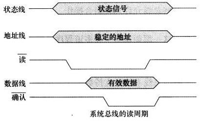

图片来自课件第 **32 页**。横向由左到右表示时间；高低线段表示电平，斜边包围的区域表示一段数据有效窗口。

图中“读”和“确认”带上划线，表示 **低电平有效**。所以波形下降时是“发出／有效”，上升时是“撤销／无效”。

沿着图逐步读：

1. CPU 先给出稳定的状态信号和地址。
2. CPU 使读信号有效，通知主存开始读取。
3. 主存找到内容，把有效数据放到数据线上，然后使确认信号有效。
4. CPU 看到确认有效后接收数据，接收完成后撤销读信号。
5. 主存检测到读信号撤销，随后撤除数据及确认信号。

**不能在“刚发出读命令”时就把数据当成有效；要等数据准备好，并满足协议规定的接收条件。**

##### 看懂课件原图：异步写周期

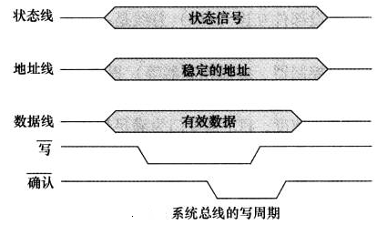

图片来自课件第 **33 页**。“写”和“确认”同样是低电平有效。

这次 CPU 先准备地址和待写数据，然后使写信号有效。主存按协议接收数据并给出确认，CPU 再结束写请求；双方随后撤销相关信号。

与读操作相比，**数据方向改变了**：读时主存送数据给 CPU，写时 CPU 送数据给主存。两次事务中 CPU 都可以是主设备。

##### 教材补充：异步串行帧，不靠每个字符共享时钟起点

教材书页 **62–64** 讲了串行字符帧。这与前面“串行／并行”的分类相接，也解释为什么线上传了许多位，有效数据却没有那么多。

异步串行常按一个字符一帧：**起始位 → 数据位 → 可选校验位 → 停止位**。起始位帮助接收方识别本帧开始；双方还须约定每位时间。没有本次通信的公共时钟，不代表位宽可以随意变化。两帧之间可有空闲间隔。

**教材例 3.3（书页 63）**：发送 `95H`，1 起始位、8 数据位、1 偶校验位、1 停止位。

$$
95_{16}=1001\,0101_2\quad\text{（写数时从 }D_7\text{ 到 }D_0\text{）}
$$

数据位从低位 $D_0$ 先发，所以时间顺序为 `1 0 1 0 1 0 0 1`。数据有 4 个 1，已是偶数，偶校验位取 0。

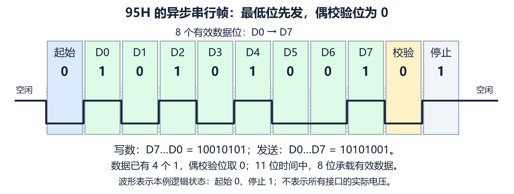

**一帧共 11 位时间，只有 8 位是有效数据**。图上空闲和停止为 1、起始为 0，表示这里的逻辑状态；不能将它直接当作所有串行接口的物理电压。

###### 两种速率：线上总位率与有效数据率

教材的这些二值串行例子，每个码元承载 1 bit，因而波特率（码元/s）与线上总位率（bit/s）数值相同。教材此处用“比特率”统计有效数据位；为避免混淆，下面直接写“有效数据率”。一般的波特率不能不看编码就等同于 bit/s。

| 量 | 这些例子中怎么求 |
| --- | --- |
| 一帧位数 $n$ | 起始位 + 数据位 + 校验位 + 停止位 |
| 连续传输所需线上总位率 | $n\times$ 每秒字符数 |
| 有效数据率 | 线上总位率 $\times$ 数据位数 $/n$ |

**教材例 3.2（书页 62–63）**：每秒 120 帧，每帧为 1 起始 + 7 数据 + 1 校验 + 1 停止，即 10 位。连续传送时需 $10\times120=1200$ bit/s，在上述二值条件下为 1200 Baud；其中有效数据只有 $7\times120=840$ bit/s。

**教材例 3.4（书页 64）**：1200 Baud，每帧 1+8+1+1=11 位，无额外空闲，则有效数据率为：

$$
1200\times\frac{8}{11}\approx872.73\ \text{bit/s}
$$

教材写 872.72 bps；这里保留到两位小数按通常四舍五入得到 872.73。重点是 **乘有效位占比**。若帧间另有空闲，平均有效速率还会更低。

同步串行（图 3.21，书页 64）按数据块组织，用 SYN 同步字符帮助确定起点，减少逐字符起止位的开销。与前面的突发传输类似，组织多份数据可以摊薄一些开销，但两者不是同一种协议。

#### 半同步通信：按时钟走，遇到慢设备插入等待

半同步保留公共时钟，同时增加等待响应信号。教材图 **3.22（书页 65）**、课件第 **34–36 页**使用低电平有效的 $\overline{\mathrm{WAIT}}$ 信号，下面的 0/1 指这根实际信号线的电平：

- **WAIT = 0**：设备尚未满足继续传输的条件，再等待一个时钟周期。
- **WAIT = 1**：可以继续，进入后续传数与结束阶段。


教材和课件的例子在 T2 和 T3 之间插入了两个等待周期：

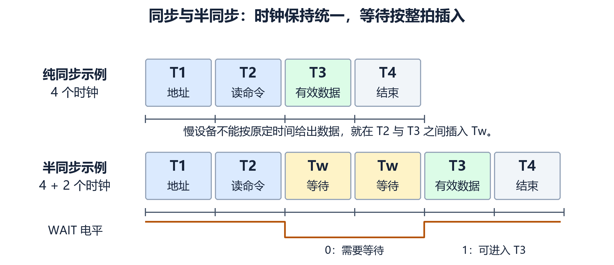

每个小格是一整个时钟周期。半同步要在规定的时钟采样点检查 WAIT；即使设备在两个采样点之间准备好，也要按协议等到规定边沿继续。等待周期的长度与时钟周期一致。

$$
T_1\rightarrow T_2\rightarrow T_W\rightarrow T_W\rightarrow T_3\rightarrow T_4
$$

若基本传输需要 4 个时钟，插入 $m$ 个等待时钟，则：

$$
t_{\text{传输}}=(4+m)T
$$

**例：20 MHz，32 位数据，每次传一份完整数据，插入 2 个等待周期，无传输重叠。**

$$
T=\frac{1}{20\times10^6}=50\ \text{ns}
$$

$$
t_{\text{传输}}=6\times50=300\ \text{ns}
$$

$$
B=\frac{4\ \text{B}}{300\ \text{ns}}\approx13.33\ \text{MB/s}
$$

要算这次完整传输的速率，就要把等待时间算进去。只用 $4\times20\ \text{MHz}$ 得到的 80 MB/s，不符合本题的六拍条件。

#### 分离式通信：发送请求后，把总线让出来

同步、异步和半同步解决了“什么时候继续”的问题。另一个效率问题是：**主存准备数据期间，总线上可能没有有效数据传送，却仍被这笔尚未结束的事务占着。**

分离式通信把请求与返回拆成两个子周期。

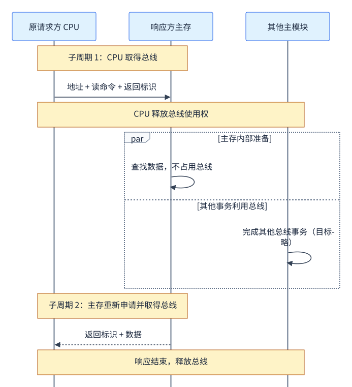

图中框内的两项工作可以重叠进行：主存准备数据时，其他模块使用总线完成自己的事务。

1. **子周期 1**：请求方申请总线，发送地址、命令以及识别返回目标所需的信息，然后释放总线。
2. 从模块在内部准备数据；这时其他模块可以申请并使用总线。
3. **子周期 2**：数据准备好后，响应模块重新申请总线，把数据返回给原请求方，再释放总线。

补充：实际协议需要办法把返回数据与原请求对应起来，例如目标信息或事务标识。图中的“标识”仅用于解释这个需求。

**关键区别是准备期间释放了总线使用权，让其他事务能够利用这段时间。**

教材书页 **65–66**、课件第 **39 页**强调：各模块都须申请使用权，子周期在规定时间内采用同步方式传输，准备阶段不占用总线。这说明“分离式”讨论事务组织方式，可以与同步时序结合。原来的响应方在返回阶段重新申请使用权，也会成为该子周期的主模块。它需要保存请求和识别返回目标，控制较复杂；教材把它放在大型系统中介绍。

> [!note] 用数字理解收益
> 假设发送请求要 10 ns，主存内部准备要 80 ns，返回数据要 10 ns。
>
> 若一直保留总线使用权，这次事务持续约 100 ns，其中 80 ns 没有有效数据传送。分离式使请求和返回分别占用总线，准备期间的 80 ns 可供其他事务利用。
>
> 它提高的是总线利用率和整体吞吐机会；本次读取依然要等待主存准备，重新仲裁还可能增加延迟。以上忽略额外开销，只用来说明机制。

> [!warning] 核对课件第 37 页的“不占用总线”
> 第 37 页把“从模块准备数据”同时标成“不占用总线”和“总线空闲”，容易让人误以为其他主设备已经可以使用总线。
>
> 结合教材书页 65–66 与课件第 38–39 页，这里的空闲应理解为 **没有有效信息在传送**。在前述未分离的传输中，事务尚未结束，使用权通常仍由当前事务保留。分离式则明确释放使用权，允许别的事务在准备期间使用总线。

#### 四种方式放在同一张表里

| 方式 | 怎样决定继续传输 | 时间特点 | 最关键的记忆点 |
| --- | --- | --- | --- |
| 同步 | 按公共时钟及预定时刻 | 课件的纯同步例子采用固定安排 | 按共同时间表 |
| 异步 | 按请求与应答 | 完成时间取决于设备响应 | 准备好后应答 |
| 半同步 | 公共时钟下检查等待信号 | 允许插入等待时钟 | 按时钟走，可以等 |
| 分离式 | 请求、返回分别取得总线使用权 | 准备期间释放总线，课件子周期用同步传输 | 等待时让其他事务使用 |

## 复习与练习：讲清主线，再检查计算

### 合上笔记，试着说出这一段话

> 总线是部件共享的信息通路。系统总线按内容分为地址、数据和控制。数据线位数决定一次传输宽度，地址位数决定能区分的地址数量。共享总线要先仲裁使用权，再按通信规则传输。集中式仲裁有链式、计数器和独立请求。通信有同步、异步、半同步，分离式把请求与返回拆开，在准备数据时释放总线。

如果某句话说不出来，就回到对应小节看图，不必从头重读全部课件。

### 10 道自测，点开查看答案

> [!question]- 1. CPU 读主存时，谁是主设备？谁发送数据？
> CPU 发起并控制事务，是主设备；主存返回数据，是数据发送方。主设备和数据发送方可以不同。

> [!question]- 2. 单总线结构为什么还分地址、数据、控制？
> “单总线”数的是共享通路／总线组。该总线内部仍包含不同用途的信号线。

> [!question]- 3. 20 根地址线，按字节编址，最多能区分多少地址？容量多少？
> $2^{20}$ 个地址，每个地址 1 B，总容量 $2^{20}$ B = **1 MiB**。

> [!question]- 4. 64 位数据总线，100 MHz，每个时钟传一次完整数据，峰值带宽是多少？
> 每次 $64/8=8$ B。$8\times100\times10^6=800\times10^6$ B/s，即 **800 MB/s**。

> [!question]- 5. 32 位数据总线，40 MHz，每 4 个时钟传一份数据，且不能重叠，带宽是多少？
> 每次 4 B，一次用时 $4/(40\times10^6)=100$ ns，所以 $4/100$ ns = **40 MB/s**。直接乘 40 MHz 得到 160 MB/s，漏掉了每次要 4 拍的条件。

> [!question]- 6. 链式查询中，设备 0 不申请，设备 1、2 申请，授权顺序是 0→1→2，谁获准？
> 设备 1。设备 0 传递 BG，设备 1 截获授权，设备 2 继续等待。

> [!question]- 7. 计数器查询怎样改善公平性？
> 从上次服务设备的下一编号开始循环查询。若每次固定从 0 开始，低编号仍可能一直优先。

> [!question]- 8. 全互锁的四个动作是什么？
> **请求有效 → 回答有效 → 请求撤销 → 回答撤销。** 主设备等回答才撤请求，从设备等请求撤销才撤回答。

> [!question]- 9. 基本传输为 4 拍，时钟周期 25 ns，插入 3 个等待周期，一次传输多久？
> $(4+3)\times25=\mathbf{175\ ns}$。若一次传 32 位，即 4 B，则在无重叠且忽略其他开销时，速率约为 $4/175$ ns = **22.86 MB/s**。

> [!question]- 10. 分离式为什么提高总线利用率？是否必然让单次读更快？
> 请求发出后释放总线，从模块准备数据期间可以安排其他事务。它改善总线利用率，但不消除主存内部的准备时间，单次读取也可能承担额外仲裁延迟。

### 教材章末题怎么练（书页 66–67）

这些是按题号整理的练习路线与参考思路，答案是本笔记的推导，供对照理解。

| 练习目标 | 对应教材题号 | 回看本笔记 |
| --- | --- | --- |
| 总线概念、三类信号、位数之间的关系 | 3.1、3.2、3.5 | 3.1、3.2、3.3.2 |
| 结构与性能：为什么加通路、是否真的能并行 | 3.3 | 3.4，特别是 DMA 三总线 |
| 三种判优、响应速度、故障敏感性 | 3.4 | 3.5.1 |
| 同步／异步、互锁、半同步、分离式 | 3.6–3.9 | 3.5.2 的图与比较表 |
| 标准与即插即用 | 3.10 | 3.3.3 |
| 驱动与接收：双向通路、一发多收 | 3.11、3.12 | 3.1 的“共享”说明；需要电路设计时再展开 |
| 速率与串行帧计算 | 3.13–3.16 | 下面三题 |

> [!question]- 教材习题 3.14：16 位、8 MHz，每个总线周期 1 个时钟，每周期传一份数据，带宽？
> 一份 $16/8=2$ B，速率 $2\times8\times10^6=\mathbf{16\ MB/s}$。这里题目明确了一个总线周期等于一个时钟周期，不应拿某个标准表格的数值替代计算。

> [!question]- 教材习题 3.15：32 位、66 MHz，每份数据的总线周期 4 个时钟，传输率？怎样提高？
> $B=(32/8)\times66\times10^6/4=\mathbf{66\ MB/s}$。在其他条件固定时，增加宽度、提高时钟或减少每份数据所需时钟都能改善；是否可行取决于电气、设备与协议约束。若采用突发等方案，也要重新计算开销与传数次数。

> [!question]- 教材习题 3.16：每字符 1 起始、8 数据、1 校验、2 停止，每秒 120 字符，求波特率与有效数据率。
> 每帧 $1+8+1+2=12$ 位；无额外帧间空闲且每码元 1 bit 时，所需线上速率为 $12\times120=\mathbf{1440\ bit/s}$，相应为 **1440 Baud**。有效数据率 $8\times120=\mathbf{960\ bit/s}$，也可由 $1440\times8/12$ 得到。

### 最容易混淆的概念

| 容易混淆 | 分辨依据 |
| --- | --- |
| 数据宽度／地址位数 | 一次传多少数据／能区分多少地址 |
| MHz／MB/s | 每秒多少时钟／每秒多少字节 |
| 仲裁／通信 | 谁有使用权／怎样完成交换 |
| BG／ACK | 仲裁授权／从设备传输应答 |
| 主设备／数据发送方 | 谁发起和控制／谁把本次数据送上总线 |
| 半互锁／半同步 | 异步握手依赖关系／时钟配合等待信号 |
| 复用／突发／分离式 | 省连线／摊薄连续数据开销／利用内部准备期间的总线时间 |
| 线上总位率／有效数据率 | 包括起止校验等附加位／只统计实际数据位 |
| 多主设备／同时发送 | 多个模块有资格申请／同一共享通路仍须避免多个源冲突 |
| 总线无数据传送／使用权已释放 | 没有有效传数／其他事务可以申请使用 |
| 标称峰值／实际吞吐率 | 理想传输条件／包含协议、等待等开销 |

## 图与来源：回到原材料的位置

教材：唐朔飞《计算机组成原理》第二版，第三章“系统总线”，**书页 41–67（PDF 第 52–78 页）**。原文件位置：`D:\WHUT\计算机组成与系统结构\计算机组成原理第二版-唐朔飞.pdf`。课件：[[课件/03.pptx|03.pptx]]，39 页。

| 关键图／例题 | 教材位置 | 笔记中的解释 |
| --- | --- | --- |
| 图 3.1–3.3 | 书页 42–43 | 开头连接方式为何改变 |
| 图 3.7–3.10 | 书页 53–54 | 通道、DMA、分层与四总线 |
| 图 3.11–3.14 | 书页 55–57 | 传统 → VL-BUS → PCI，桥与负载 |
| 图 3.15 | 书页 58 | 三种集中式判优 |
| 图 3.16–3.17、例 3.1 | 书页 60–61 | 同步读写时序与四拍带宽 |
| 图 3.18 | 书页 62 | 不互锁、半互锁、全互锁 |
| 图 3.19–3.21、例 3.2–3.4 | 书页 62–64 | 串行字符帧、95H、附加位与有效速率 |
| 图 3.22 | 书页 65 | 半同步与整拍等待 |
| 分离式的两子周期 | 书页 65–66 | 释放使用权，内部准备与其他事务重叠 |
| 思考题与习题 3.1–3.16 | 书页 66–67 | 复习路线与计算题参考推导 |

**配图说明**：01–11 为根据课件重画的教学图；12–13 提取自课件第 32、33 页；14–19 为结合教材补画的动机图、突发对照、DMA 结构、互锁关系、95H 串行帧及同步／半同步周期对照。示意图省略当前解释不需要的电气细节，颜色只区分任务与模块；高低电平和采样时刻以各图说明为准。

涉及 PCI、USB 的官方核对链接保留在 3.3.3，相邻说明解释了它们支持的具体参数。教材与课件的历史标准数字应结合当时版本和传输条件理解。
