# 第4章 存储器（知识点与电路图解）

依据 [[课件/04.pptx|第四章课件]]（122 页）与唐朔飞《计算机组成原理》第二版第四章整理。教材的思路是：**先认识存储层次，再从存储一位的电路出发组成芯片，把芯片连成主存，最后解决速度、容量与可靠性问题。**

**页码约定**：书页是教材印刷页码，PDF 页码 = 书页 + 11。第四章正文与习题见书页 **68–153**（PDF 第 79–164 页），附录 4A 见书页 153–155（PDF 第 164–166 页）。PPT 页码为幻灯片序号，包含连续动画拆出的多页。

> [!abstract] 用五个问题串起本章
> ① 哪种物理状态能保存 0/1？② 地址怎样选中它？③ 怎样把芯片连到 CPU？④ 怎样让 CPU 更快得到数据？⑤ 怎样发现存储和传输中的错误？
>
> SRAM/DRAM 回答①；译码与容量扩展回答②③；交叉存储与 Cache 回答④；汉明码、CRC 回答⑤。辅存提供低成本的大容量后援。

## 阅读路线与内容地图

第一遍读 **4.1、4.2.1**，把容量、地址、时间单位分清。第二遍读 **4.2.2、4.2.3、4.2.5**，沿电路中的信号线看一次读写。第三遍学 **4.2.6、4.2.7、4.3**，练校验、并行访问与 Cache 计算。辅存部分按概念、磁盘计算、编码波形、CRC 的顺序阅读。

| 内容 | 本节要解决的问题 | 教材书页 | PPT |
| --- | --- | --- | --- |
| [[#4.1 概述：用不同层次兼顾速度、容量与成本\|4.1 概述]] | 分类、层次及它们解决的矛盾 | 68–72 | 1–7 |
| [[#4.2.1 主存概述：地址、内容和访问时间\|4.2.1 主存概述]] | 地址、容量、读写过程、存取时间 | 72–74 | 8–12 |
| [[#4.2.2 半导体存储芯片：片选与片内译码\|4.2.2 芯片与译码]] | 芯片引脚、片选、行列选择 | 74–76 | 13–20 |
| [[#4.2.3 随机存取存储器 RAM\|4.2.3 RAM]] | SRAM、DRAM 的电路和刷新 | 76–88 | 21–63 |
| [[#4.2.4 只读存储器 ROM\|4.2.4 ROM]] | 掩模、熔丝、浮栅及擦写方式 | 88–91 | 64–67 |
| [[#4.2.5 存储器与 CPU 的连接\|4.2.5 与 CPU 连接]] | 位扩展、字扩展、地址分配、片选 | 91–99 | 68–76 |
| [[#4.2.6 存储器的校验：用汉明码定位一位错\|4.2.6 校验]] | 汉明码如何产生、定位一位错 | 100–103 | 77–84 |
| [[#4.2.7 提高访存速度：变快、变宽与重叠访问\|4.2.7 提速]] | 单体多字、多体交叉、存控 | 103–109 | 85–93 |
| [[#4.3 高速缓冲存储器 Cache\|4.3 Cache]] | 局部性、映射、替换、读写与性能 | 109–123 | 94–106 |
| [[#4.4 辅助存储器\|4.4 辅存]] | 磁记录、磁盘、磁带、CRC、光盘 | 123–150 | 107–122 |

### 电路图先看这些符号

- **黑点**表示导线相连；交叉但没有黑点，表示两根线各自通过。
- `CS#`、`WE#`、`OE#`、`RAS#`、`CAS#` 中的 `#` 与教材的上划线含义相同：**低电平有效**。例如 `CS#=0` 才选中芯片。
- 门电路端口的**小圆圈表示反相**。带圆圈的“与门”不能去掉圆圈后直接按普通 AND 使用。
- MOS 管的栅极是控制端，图中把它当作控制导通／截止的开关来理解；栅极不与源漏通路直接短接。
- `A9…A0` 表示一组 10 位地址线，`D7…D0` 表示一组 8 位数据线。粗线表示总线，各位仍是独立导线。

读电路时依次找：**电源与地 → 地址和片选 → 读写条件 → 数据实际经过的通路**。配图是教学原理图，省略器件尺寸、衬底和不影响当前解释的辅助电路；引脚功能与连接逻辑会单独标明。

## 4.1 概述：用不同层次兼顾速度、容量与成本

### 4.1.1 存储器的分类

| 分类依据 | 类别与例子 | 理解重点 |
| --- | --- | --- |
| 存储介质 | 半导体、磁表面、磁芯、光存储 | 靠什么物理状态保存信息 |
| 访问方式 | 随机访问、顺序访问、直接访问 | 找到目标信息要经过什么过程 |
| 读写特性 | RAM、ROM 及可编程／可擦写 ROM | 正常运行时能否方便地修改内容 |
| 系统中的作用 | Cache、主存、辅存 | 处在哪一层，服务什么需求 |
| 断电后能否保留 | 易失性、非易失性 | 断电后信息是否仍能保存 |

**随机访问**表示访问时间在本章模型中不取决于存储单元的物理位置，不是“随机挑一个地址”。磁带要按顺序走带，属于顺序访问；磁盘先定位磁道，再等扇区转到磁头下，属于直接访问。

SRAM、DRAM 都是易失性 RAM。ROM、Flash 也是半导体存储器，却能非易失地保存信息，所以不能把“半导体”与“断电丢失”直接画等号。各分类依据彼此独立。

### 4.1.2 存储器层次

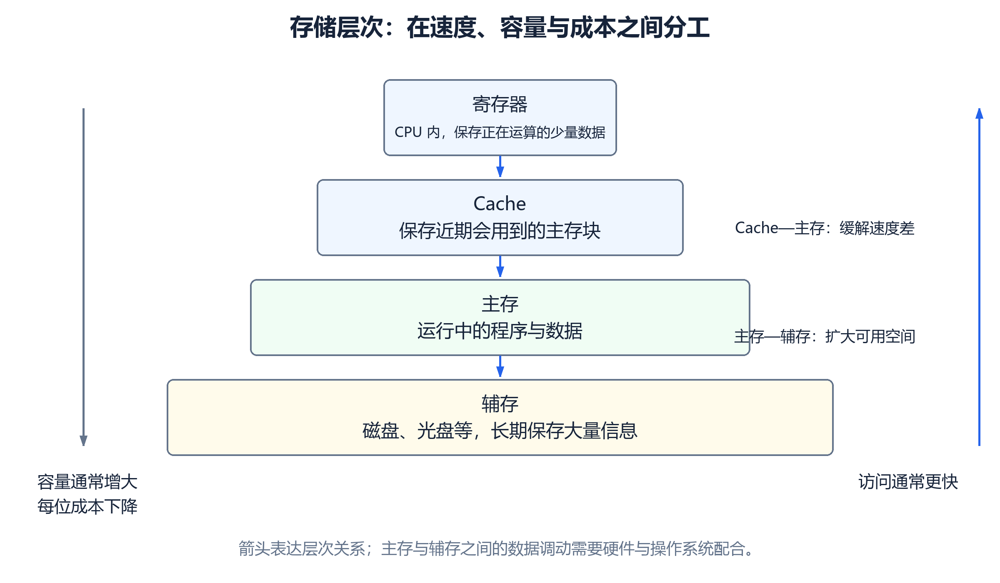

| 层次 | 主要解决的问题 | 数据调动由谁完成 |
| --- | --- | --- |
| Cache–主存 | CPU 与主存的速度差距 | 主要由硬件自动完成，对普通程序透明 |
| 主存–辅存 | 可供程序使用的容量与成本 | 硬件与操作系统配合 |

寄存器离运算部件最近；Cache 保存近期可能使用的主存块；主存保存正在运行需要的程序与数据；辅存保存大量文件和暂未调入主存的信息。通常向下容量增大、单位容量成本下降、访问速度变慢。

**虚拟存储器**建立在主存–辅存层次上，把程序使用的虚拟／逻辑地址映射为物理地址；所需内容不在主存时，要先调入主存。它不是在 CPU 与辅存之间凭空添了一块同样快的大内存。这里先掌握层次思想，详细地址转换留给后续课程。

## 4.2 主存储器

### 4.2.1 主存概述：地址、内容和访问时间

#### 一次读写，哪些部件做什么

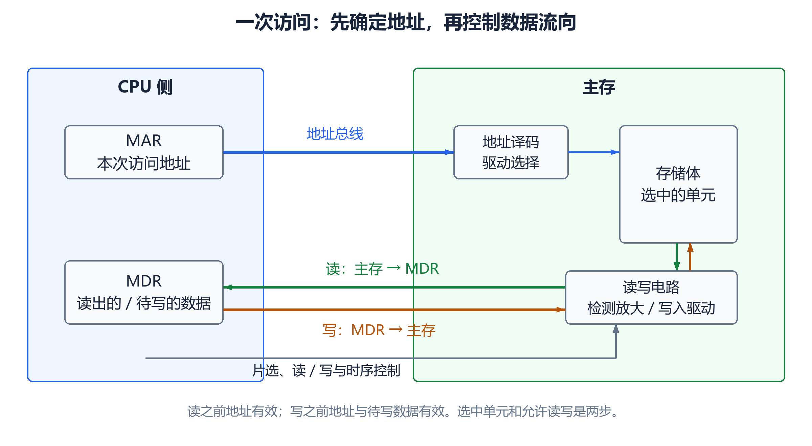

| 部件 | 作用 |
| --- | --- |
| MAR（地址寄存器） | 暂存这次要访问的地址 |
| 地址译码器、驱动器 | 把二进制地址变成选中单元的信号 |
| 存储体 | 由大量能保存 0/1 的基本电路组成 |
| 读写电路 | 读时检测并放大信号，写时驱动数据进入单元 |
| MDR（数据寄存器） | 暂存读出的数据或准备写入的数据 |
| 控制电路 | 协调片选、读写及各信号的时序 |

**读**：地址进入 MAR，经地址总线和译码选中单元；读命令有效后，存储体的内容经读电路、数据总线送到 MDR。**写**：地址进入 MAR，待写内容进入 MDR；地址和数据准备好后，使写命令有效，把内容写入选中的单元。图中将 MAR/MDR 放在 CPU 一侧，与教材图 4.5 对应。

#### 基元、编址单元、字，先区分对象

| 名称 | 本笔记中的含义 |
| --- | --- |
| 基本存储电路／存储基元 | 保存 **1 bit** 的电路，例如一个六管 SRAM 单元 |
| 编址单元 | 一个地址对应的最小可寻址单位，可为 1 B，也可为一个字 |
| 存储字长 | 一次按存储字组织的位数，按题目给定 |
| 芯片规格 $N\times W$ 位 | 有 $N$ 个芯片地址，每个地址对应 $W$ 位数据 |

例如 `1K×4 位`：有 $2^{10}=1024$ 个地址，每个地址存 4 bit，总共 $4096$ 个一位基元，容量为 $4096/8=512$ B。芯片不是只有 1024 bit。

#### 24 根地址线：两种题目条件必须分开

先记两个换算：$1\text{ B}=8\text{ bit}$，$1\text{ MiB}=2^{20}\text{ B}$。本笔记用 KiB、MiB 明确二进制容量，教材容量题中的 K、KB、MB 通常按 $2^{10}$ 等理解。

**情况 A：教材书页 73、PPT 第 10 页的字节编址空间。** 24 位地址对应 $2^{24}$ 个字节：

$$
C=2^{24}\times1\text{ B}=\frac{2^{24}}{2^{20}}\text{ MiB}=16\text{ MiB}
$$

在这块固定的 16 MiB 空间内，若一个字为 32 位，即 4 B，则能存：

$$
N_{\text{字}}=\frac{2^{24}\text{ B}}{4\text{ B/字}}=2^{22}\text{ 个字}=4\text{ M 个字}
$$

字的起始**字节地址**依次为 `0、4、8、…`。若每字 16 位，则每字 2 B，共有 $2^{23}=8$ M 个字。**改变按几个字节分成一个字，并没有增加物理容量。**

**情况 B：题目另行规定“每一个 24 位地址直接对应一个 32 位字”。** 此时共有 $2^{24}$ 个字，每字 4 B：

$$
C=2^{24}\times4\text{ B}=2^{26}\text{ B}=64\text{ MiB}
$$

这就是上一章“24 位**字地址**”例子的条件。如果要把这 64 MiB 中每个字节都独立编号，需要 26 位字节地址。

| 条件 | 地址对应的单位 | 字节容量 | 32 位字数 |
| --- | --- | --- | --- |
| 24 位字节地址 | 1 B | 16 MiB | 4 M |
| 24 位字地址，一个字 32 位 | 4 B | 64 MiB | 16 M |

> [!important] 做容量题先把这句话补完整
> “这里的一个地址对应 **____ B**。”然后再用：**容量 = 地址数 × 每个地址对应的字节数**。若题目已经给出总字节容量，求字数应除以字节／字。

#### 大端、小端与地址

教材图 4.6 中“用高位字节／低位字节的地址表示字地址”，涉及一个字的字节如何排列。以 32 位数 `0x12345678` 放在从 `0x1000` 开始的连续 4 个字节为例：

| 字节地址 | 大端：高位字节先放 | 小端：低位字节先放 |
| --- | --- | --- |
| 0x1000 | 12 | 78 |
| 0x1001 | 34 | 56 |
| 0x1002 | 56 | 34 |
| 0x1003 | 78 | 12 |

两者都占 4 B；下一个对齐的 32 位字都可从 `0x1004` 开始。字节顺序改变的是内容的排列。

#### 存取时间、存取周期、带宽

| 指标 | 含义 | 算题时看什么 |
| --- | --- | --- |
| 存取时间 $t_a$ | 从有效地址等条件建立，到本次读／写完成所需时间 | 一次操作多久得到结果 |
| 存取周期 $T$ | 连续两次独立操作之间允许的最小间隔 | 多久可以再启动一次 |
| 带宽 $B$ | 单位时间完成的有效信息量 | 每次传多少、多久完成一次 |

存储器可能在读完数据后还要恢复、预充电，所以存取周期通常大于或等于存取时间。

$$
B=\frac{\text{每周期传送的字节数}}{\text{存取周期}}
$$

教材书页 74 的例子是每 500 ns 传 16 bit：$16/(500\times10^{-9})=32\text{ Mbit/s}=4\text{ MB/s}$。若数据总线为 32 位、每 200 ns 传一份，则为 $4\text{ B}/200\text{ ns}=20\text{ MB/s}$。要用完成这些数据传送的周期，不能随意改用更短的读出时间。

### 4.2.2 半导体存储芯片：片选与片内译码

#### 地址线、数据线、控制线

| 芯片规格 | 地址数 | 完整地址的位数 | 一次数据位数 | 总容量 |
| --- | --- | --- | --- | --- |
| 1K×4 位 | $2^{10}$ | 10 | 4 | 512 B |
| 16K×1 位 | $2^{14}$ | 14 | 1 | 2 KiB |
| 8K×8 位 | $2^{13}$ | 13 | 8 | 8 KiB |

这张表先按**地址不复用**理解。DRAM 可以先后传行地址和列地址，使物理地址引脚少于完整地址的位数，见后文。

`CS#/CE#` 决定**哪颗芯片参加本次操作**；芯片的地址端决定选中该芯片内部的**哪个位置**；`WE#/OE#` 等决定写入还是允许输出。片选无效时，共享数据总线的输出应处于高阻态 Z，避免别的芯片正在送数据时发生冲突。Z 表示不驱动线路，不代表输出逻辑 0。

**2114 的教学控制表**（只有 `CS#` 与 `WE#`，书页 77）：

| CS# | WE# | 状态 | 数据端方向 |
| --- | --- | --- | --- |
| 1 | 任意 | 未选中 | 输出为 Z |
| 0 | 1 | 读 | 芯片输出 |
| 0 | 0 | 写 | 芯片接收 |

其他芯片还可能有独立的 `OE#`。因此“WE#=1”本身并不足以让一颗未选中的芯片输出数据。

#### 线选法与重合法

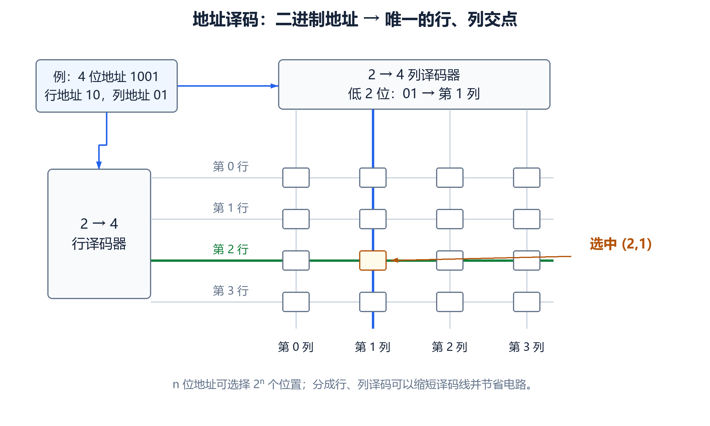

图左是一个小规模的 **2–4 译码器**：地址 `A1A0=10` 时，只有 $Y_2=A_1\overline{A_0}$ 有效。它把 2 位二进制编号变成 4 条线中的一条有效。

- **线选法**：译码后用一根字线直接选中一个存储字的所有位。`16×8 位` 的例子要 4 根输入地址线、16 根字选择线，每次选中同一行 8 个基元。
- **重合法**：把完整地址分成行、列两部分，行与列共同决定目标。`1K×1 位` 可排成 `32×32`：输入 10 位地址，拆成 5 位行地址和 5 位列地址，各译成 32 条选择线。

为什么 64 条选择线能选 1024 个位置？因为位置是**一行与一列的组合**：$32\times32=1024$；译码后的选择线数是 $32+32=64$。这两个数分别是“组合数量”和“选择线数量”。外部完整地址仍然是 10 位。

### 4.2.3 随机存取存储器 RAM

#### SRAM：用反馈电路保持 0/1

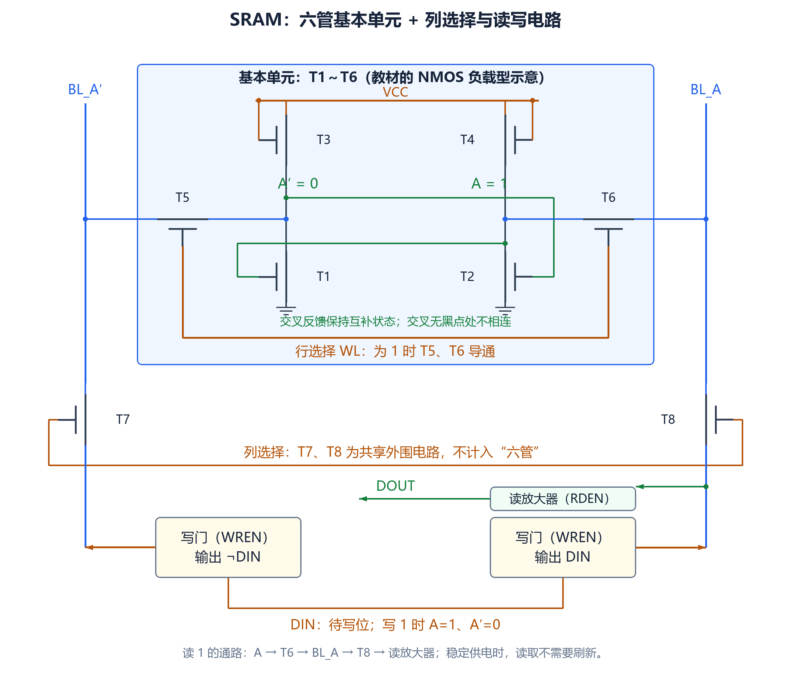

对应教材图 4.11（书页 77）、PPT 第 21–23 页。图中采用教材的 **NMOS 负载式六管单元**：

| 器件 | 作用 | 是否属于保存一位的六管单元 |
| --- | --- | --- |
| T1、T2 | 交叉反馈的下拉管 | 是 |
| T3、T4 | 上拉负载，与 T1/T2 组成双稳态电路 | 是 |
| T5、T6 | 行开关，接通存储节点与位线 | 是 |
| T7、T8 | 列开关，接通选中列与外围读写电路 | 否，一列共用 |

**保持**：设节点 $A=1$，则 $A'=0$；反馈使两个节点互相维持相反电平。字线不选中时，T5/T6 截止，把该单元与位线隔离。电源保持时可维持状态，不需要像 DRAM 那样定时刷新；断电仍会丢失信息。

**读出 1 的路径**：行选通，使 T5/T6 导通；列选通，使 T7/T8 导通；A 点的状态经 T6、位线 A、T8，到读放大器；读选择有效，输出得到 1。正常读出后反馈电路继续维持原状态，属于非破坏性读出。

**写入 0 的路径**：外围写电路把位线 A 驱动为 0、位线 A′ 驱动为 1；行、列开关导通后，把 A/A′ 强制置为 0/1；随后撤销写入和选择，反馈电路保持新状态。写入 1 时两根位线的电平相反。图中供电与接地线不表示读写数据的流向。

> [!tip] 为什么要两根互补位线
> 存储状态本来就由 A/A′ 两个相反节点表示。写入时同时建立相反电平，能可靠改变反馈状态；读出时外围电路也可利用两侧差异判断信息。

#### 2114：64×64 个一位基元，为什么规格是 1K×4 位

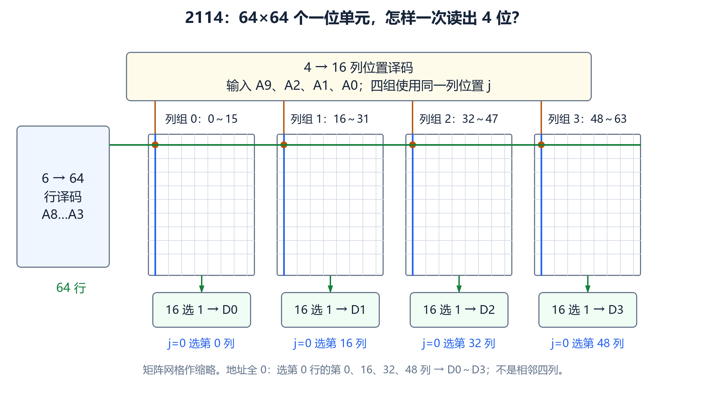

对应教材图 4.13–4.14（书页 78–79）、PPT 第 24–42 页。

1. 总基元数是 $64\times64=4096$ bit。
2. 64 列分成 **4 组，每组 16 列**，每组有一个数据端。
3. 6 位行地址 `A8…A3` 选中 64 行中的一行。
4. 4 位列地址 `A9、A2、A1、A0` 在各组中选择相同序号的一列。
5. 因此每次选中 **4 个基元，输出或写入 4 位**；共有 $64\times16=1024$ 种行列组合，正好是 `1K×4 位`。

例：地址全 0，行号 0、组内列号 0，选中第 0 行的 **0、16、32、48 列**，而不是第 0 行相邻的 0、1、2、3 列。课件连续多页动画就是在展示这条选择通路。

#### SRAM 读写时序：选中之后，数据还需要时间稳定

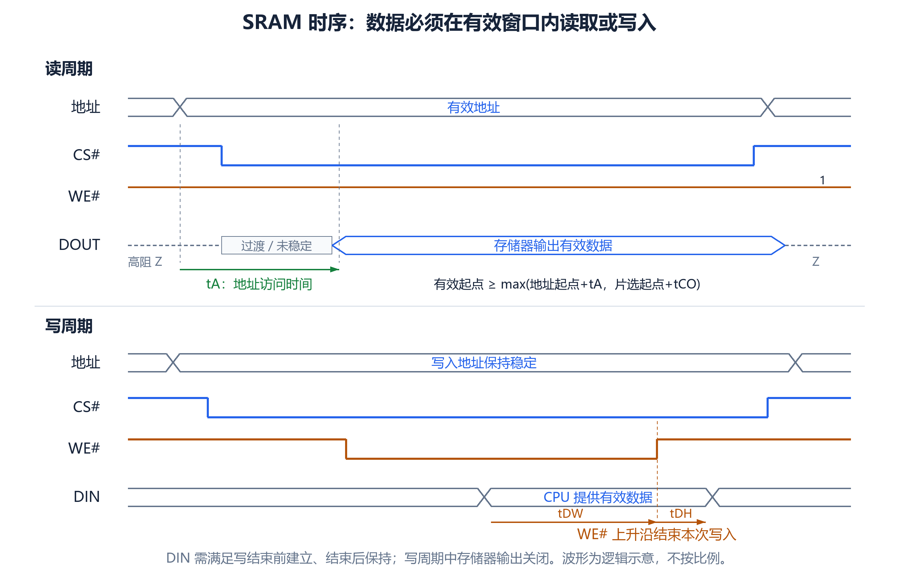

对应教材图 4.15–4.16（书页 79–80）、PPT 第 43–44 页。图中给出动作先后，具体时间数值以芯片规定为准。

读周期里，地址有效后要经过 $t_A$；片选有效后要经过 $t_{CO}$。两项条件都满足，数据才稳定。可用下式理解最早的稳定时刻：

$$
t_{\text{数据有效}}\ge\max(t_{\text{地址有效}}+t_A,\ t_{\text{片选有效}}+t_{CO})
$$

片选撤销后，输出也不会在理想的零时间内立刻变成 Z；地址变化后，旧数据可能还有短暂保持时间。CPU 必须在数据有效窗口内接收。

写周期里，地址应先稳定；写入有效区间内由 CPU 驱动数据，芯片输出关闭。**写入结束附近，数据必须提前稳定并继续保持一段时间**，分别对应建立时间 $t_{DW}$ 和保持时间 $t_{DH}$。在教材 2114 图中关注 `WE#` 撤销附近的数据窗口，不能理解成“地址、数据、WE 同时任意变化也能写入”。

#### DRAM：用电容的电荷保存信息

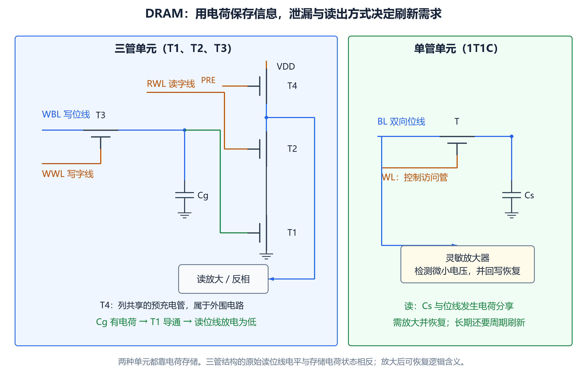

对应教材图 4.17–4.18（书页 80–81）、PPT 第 45 页。

**三管 DRAM**：T3 是写入开关，T1 的栅极电容 $C_g$ 保存信息，T2 是读出开关。T4 是一列共用的预充电管，不计入三管基本单元。

- 写入：写选择打开 T3，写数据对 $C_g$ 充电或放电。
- 读出前：T4 先把读数据线预充为高电平，再关闭预充电通路。
- 若原存 1：$C_g$ 电压高，T1 导通；读选择打开 T2 后，读数据线经 T2、T1 向地放电，线电平下降。
- 若原存 0：T1 截止，读数据线保持较高电平。

所以**三管图中读数据线的原始电平与存储节点反相**，要结合外围电路解释输出；不能把“读线低”直接等同于“原来存 0”。

**单管 DRAM（1T1C）**：只有一个访问管 T 与存储电容 $C_s$。字线控制 T，位线负责写入并感知读出的电荷变化。

- 写 1：字线选通，位线把电容充到表示 1 的状态；写 0 则放电到表示 0 的状态。
- 保持：T 截止，电容暂时保存电荷，但电荷会泄漏。
- 读：T 接通，电容与位线交换电荷，感放检测差异并恢复存储状态。这种读出会扰动原状态，**需要再生／回写**。

**刷新解决的是“长时间没有被访问的单元也会漏电”**。一次读后的恢复和周期性逐行刷新相关，但并不是同一个调度问题。

#### 4116：14 位逻辑地址，为什么只有 7 根地址引脚

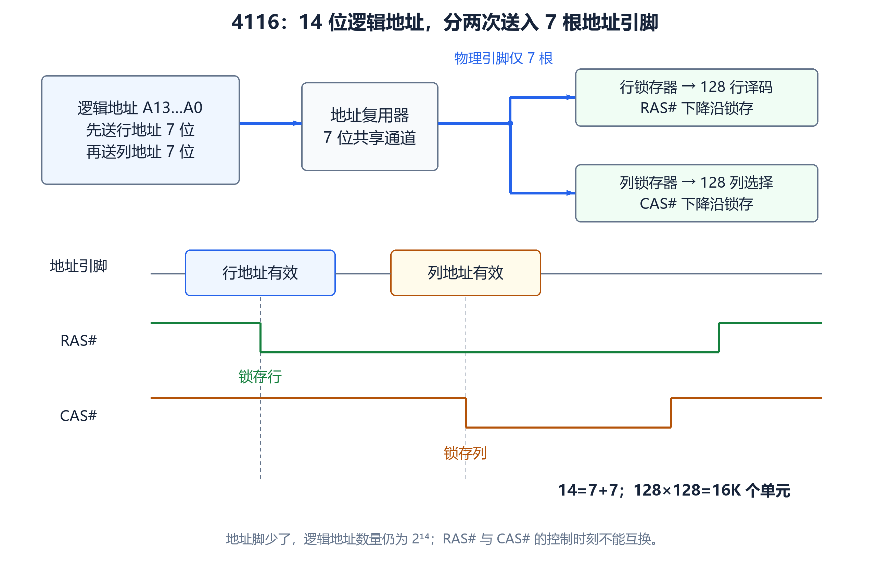

对应教材图 4.20–4.23（书页 82–85）、PPT 第 56–59 页。`4116=16K×1 位`，有 $2^{14}$ 个一位位置，逻辑地址确实需要 14 位；但它排列成 `128×128`，行列各需要 7 位。

同一组 7 根地址引脚分两次使用：**先给出行地址，在 RAS# 有效边沿锁存；再给出列地址，在 CAS# 有效边沿锁存**。图中采用高 7 位作行、低 7 位作列的教学编号。

$$
7\text{ 位行地址}+7\text{ 位列地址}=14\text{ 位完整地址},\qquad128\times128=16K
$$

读方式 `WE#=1`；写方式 `WE#=0`。RAS#/CAS# 与地址同样需要满足建立和保持时间。**减少引脚依靠时间复用，芯片可区分的逻辑位置没有减少。**

4116 的感放还兼顾一行数据的读出与恢复。教材把阵列画在感放两侧，某些内部路径在读写时反相：同一路径先后两次反相，逻辑结果仍一致。理解单元电荷、感放和列选择的分工即可，不必把内部某根线的高低当成所有芯片的统一逻辑定义。

#### DRAM 刷新：按行进行，三种安排各有代价

对应书页 86–87、PPT 第 60–62 页。这里的 **2 ms 是教材示例的最大刷新间隔**，并非所有 DRAM 的统一参数。刷新时，一行各列可同时感知并恢复，所以计数主要看**行数**。

教材例：128 行，每次刷新一行耗时 $0.5\ \mu s$，要求每行在 2 ms 内刷新一次。

$$
t_{\text{刷完所有行}}=128\times0.5\ \mu s=64\ \mu s
$$

| 方式 | 怎样安排 | 本例的计算与代价 |
| --- | --- | --- |
| 集中刷新 | 在 2 ms 内集中一段时间逐行刷新 | 连续停读写 64 μs；死时间率 $64/2000=3.2\%$ |
| 分散刷新 | 每个机器存取周期都安排“正常访问 + 刷新一行” | 每周期 $0.5+0.5=1\ \mu s$；128 μs 刷完一遍；没有集中长死区，但正常访问周期加长 |
| 异步刷新 | 把逐行刷新分散到最大间隔中 | 每隔至多 $2000/128=15.625\ \mu s$ 刷一行，每次占用 0.5 μs |

异步刷新把长死区拆成短暂停顿，刷新本身仍消耗时间。若恰能安排在 CPU 不使用主存的空档，影响可被隐藏；课件说“安排在指令译码阶段”依赖这个条件。异步刷新中的“异步”，与上一章异步握手讨论的问题不同。

#### SRAM 与 DRAM 对照

| 比较 | SRAM | DRAM |
| --- | --- | --- |
| 保存信息 | 双稳态反馈电路 | 电容电荷 |
| 基本单元 | 本教材六管示例 | 三管或单管示例 |
| 周期刷新 | 不需要 | 需要 |
| 断电保持 | 不能 | 不能 |
| 正常读出 | 保持反馈状态 | 单管读出需要恢复 |
| 本章的相对特点 | 快、集成度较低、单位容量成本较高 | 集成度高、单位容量成本较低 |
| 典型用途 | Cache | 主存 |

功耗、速度的具体倍数与工艺、容量、工作条件有关。本章重点是存储机制怎样导致刷新需求和典型用途的不同。

### 4.2.4 只读存储器 ROM

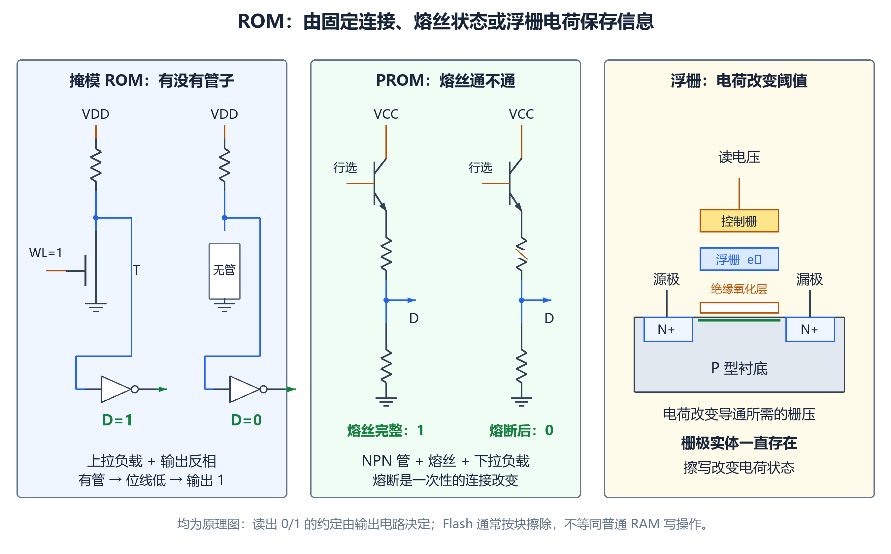

对应教材图 4.27–4.31（书页 88–91）、PPT 第 64–67 页。先看图中每种器件用什么差异表示信息，再比较如何改写。

| 类型 | 信息如何写入或改变 | 本章记忆点 |
| --- | --- | --- |
| MROM（掩模 ROM） | 制造时决定交叉处有无存储管 | 内容固定 |
| PROM | 编程电流改变熔丝是否接通 | 教材例为一次性编程 |
| EPROM | 编程改变浮栅存储电荷；紫外线擦除 | 可重编程，通常整片擦除 |
| EEPROM | 电擦除、电编程 | 可按器件支持的粒度局部修改 |
| Flash | 电编程、电擦除，通常按块／扇区擦除 | 非易失，适合高密度存储 |

**MROM 图的读法**：选中的行使存储 MOS 管导通；若该交叉处有管，列线被拉低，经过输出反相器得到 1；若没有管，列线由上拉负载维持高，反相后得到 0。“有管为 1”依赖这张图中的输出反相，不能脱离电路只背交叉点规则。

**PROM 图的读法**：教材图 4.28 用双极型管和熔丝构成通路。熔丝未断时，选中行可经该通路影响列线，表示 1；大电流把熔丝烧断后，该位置表示 0。熔丝不能通过正常读写恢复，所以只能编程一次。

**浮栅图的读法**：绝缘层中的浮栅保存电荷，影响晶体管在给定读电压下是否导通，从而区分状态。浮栅是制造时就存在的电极，编程与擦除改变的是电荷状态；教材“形成／驱散浮动栅”的文字应按这一存储机制理解。可参考 [Microchip 的浮栅存储技术说明](https://www.microchip.com/en-us/products/memory/serial-and-parallel-flash/what-is-superflash-technology)。

ROM 系列可以保存程序和常量，也能映射在 CPU 的主存地址空间中。Flash 的非易失性与可擦写性使它可承担固件或辅存等任务；其擦写规则与 SRAM 的普通写入不同，不能把“可改写”理解为任意位都能随时按 RAM 方式覆盖。

### 4.2.5 存储器与 CPU 的连接

#### 先算两个倍数，再决定线怎样接

目标规格为 $N\times W$ 位，现有芯片为 $n\times w$ 位，在尺寸整除、直接扩展的题目中：

$$
N_{\text{字扩展组数}}=N/n,\qquad N_{\text{每组并联片数}}=W/w
$$

$$
N_{\text{芯片总数}}=(N/n)\times(W/w)
$$

容量相除只能验证总片数。**还必须解释每次选中哪一组、组内每片接哪些数据位**，否则只有数量，没有完成电路设计。

#### 位扩展：地址相同，多颗芯片各提供一段数据

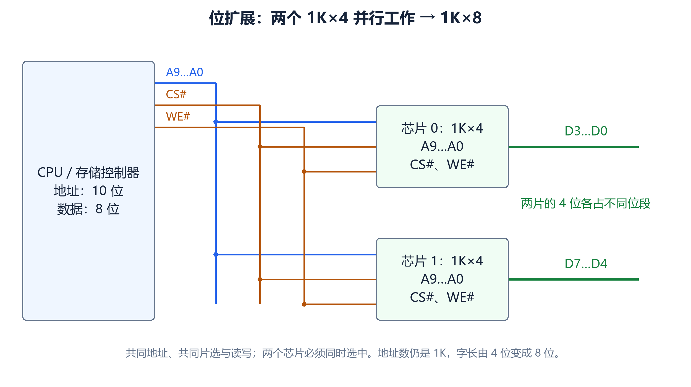

教材图 4.32（书页 92）、PPT 第 68 页：用 `1K×4 位` 组成 `1K×8 位`。

$$
\text{字数倍数}=1K/1K=1,\qquad\text{位数倍数}=8/4=2,\qquad\text{共 2 片}
$$

- 两片的 `A9…A0` 都接 CPU 的同一组低 10 位地址。
- 两片同时被片选，读写控制相同。
- 一片接 `D3…D0`，另一片接 `D7…D4`，拼成一个 8 位字。

例如 CPU 访问地址 5，两片都访问本片的地址 5；一片负责低半字节，另一片负责高半字节。**地址数量仍是 1K，字长从 4 位变成 8 位。**

#### 字扩展：增加地址，轮流选择不同芯片

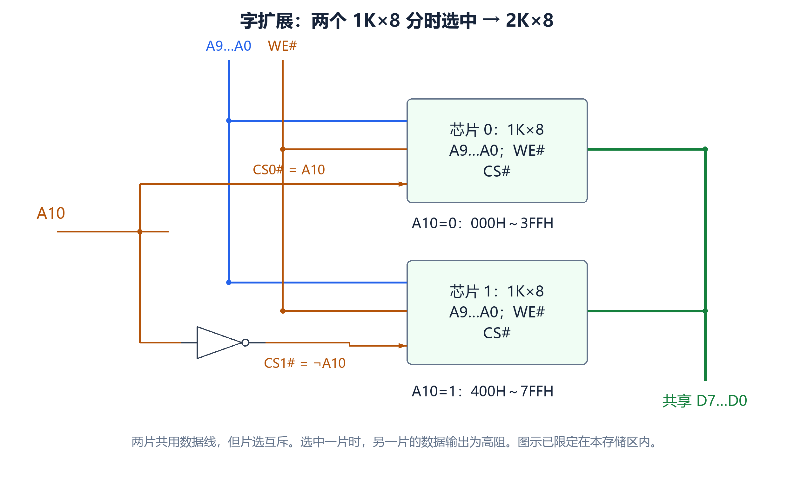

教材图 4.34（书页 93）、PPT 第 69 页：用两片 `1K×8 位` 组成 `2K×8 位`。

`2K` 需要 11 位完整地址：低 10 位 `A9…A0` 选择片内地址；新增的高位 `A10` 选择芯片。

| A10 | 选中芯片 | 总地址范围 | 片内地址 |
| --- | --- | --- | --- |
| 0 | 芯片 0 | 000H–3FFH | 000H–3FFH |
| 1 | 芯片 1 | 400H–7FFH | 000H–3FFH |

两片共用 `D7…D0`，但一次只允许一片输出。如果片选低有效，且总存储区域已使能：

$$
CS_0\#=A_{10},\qquad CS_1\#=\overline{A_{10}}
$$

如果还要加低有效的区域使能 `E#`，则可写为 $CS_0\#=E\#\lor A_{10}$，$CS_1\#=E\#\lor\overline{A_{10}}$。当 `E#=1` 时，两片都不选中。

#### 字、位同时扩展：先拼字长，再用高位选择组

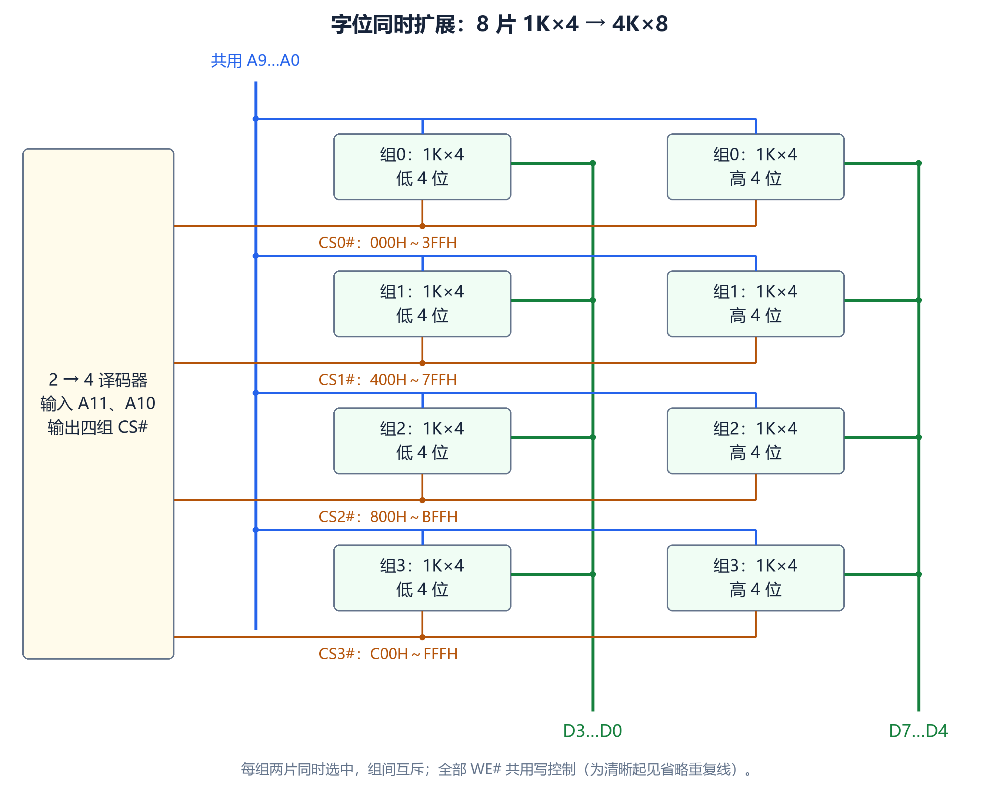

教材图 4.35（书页 93）、PPT 第 70 页：

$$
N_{\text{组}}=4K/1K=4,\qquad N_{\text{片/组}}=8/4=2,\qquad N_{\text{总片}}=8
$$

`A11、A10` 经 2–4 译码选择一组，组内两片同时工作；`A9…A0` 接所有芯片的地址端；组内数据分别接高、低 4 位。

| A11 A10 | 组号 | 该组地址范围 |
| --- | --- | --- |
| 00 | 0 | 000H–3FFH |
| 01 | 1 | 400H–7FFH |
| 10 | 2 | 800H–BFFH |
| 11 | 3 | C00H–FFFH |

教材与课件另一个例子是 `16K×1 位 → 64K×8 位`：先 8 片拼成 `16K×8 位`，再分成 4 组，合计 $8\times4=32$ 片。每次选中一组的 8 片，不会同时选中 32 片。

#### 片选设计的通用步骤

1. **确定编址单位和 CPU 地址宽度**，写出目标区域起止地址。
2. 计算区域容量：按字节编址时，$C=\text{末地址}-\text{首地址}+1$ 字节。
3. 确定 ROM/RAM 类型与数量；按字数、位数两个方向检查。
4. 低位地址接芯片片内地址端；高位地址用于选择区域、组、芯片。
5. 加入访存控制条件，给出片选的**有效电平表达式**。
6. 接数据线和读写控制线，再核对高阻、时序、负载与每片地址范围。

> [!tip] 十六进制范围常见的几个长度
> `000H–3FFH` 有 1K 个地址；`000H–7FFH` 有 2K；`000H–FFFH` 有 4K。末地址要加 1，不能把 `3FFH` 当作 1024。

#### 教材例 4.1：6000H–67FFH 的 ROM 与 6800H–6BFFH 的 RAM

对应书页 94–96、PPT 第 72–74 页。CPU 有 16 位地址、8 位数据，`MREQ#=0` 表示访存，读写线 `R/W` 高读低写。

| 区域 | 容量计算 | 选用芯片 | 片内地址 |
| --- | --- | --- | --- |
| 6000H–67FFH 系统程序 | $67FF_H-6000_H+1=800_H=2K$ B | 1 片 2K×8 位 ROM | A10…A0 |
| 6800H–6BFFH 用户程序 | $6BFF_H-6800_H+1=400_H=1K$ B | 2 片 1K×4 位 RAM 拼字长 | A9…A0 |

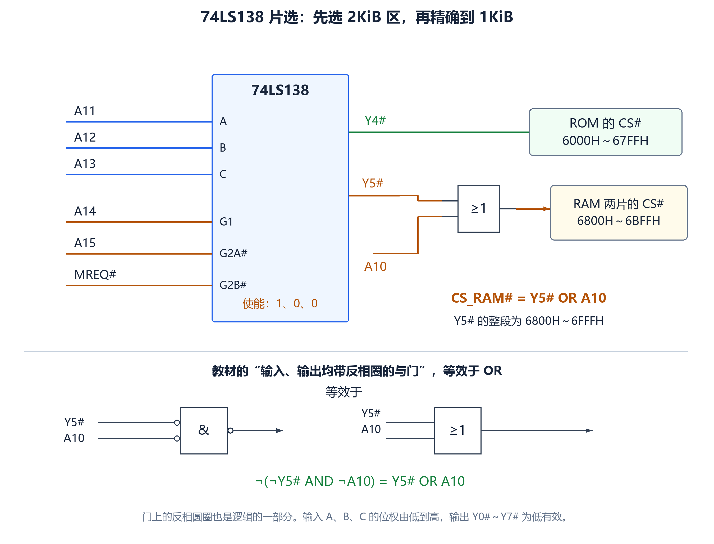

74138 的变量输入从高到低为 `C、B、A`；使能条件是 `G1=1、G2A#=0、G2B#=0`，选中的 `Yi#=0`，未选中的输出为 1。逻辑功能可对照 [TI 138 译码器功能表](https://www.ti.com/lit/ds/symlink/sn74hc138.pdf)；不同系列器件的具体电气参数另看对应规格。

按教材这道题连接：

$$
G1=A_{14},\quad G2A\#=A_{15},\quad G2B\#=MREQ\#
$$

$$
(C,B,A)=(A_{13},A_{12},A_{11})
$$

`Y4#=0` 时，`A15…A11=01100`，低 11 位任意，正好覆盖 `6000H–67FFH`。`Y5#=0` 覆盖 `6800H–6FFFH`，而 RAM 只需要其中一半，还要限制 `A10=0`：

$$
CS_{\text{ROM}}\#=Y4\#
$$

$$
CS_{\text{RAM}}\#=Y5\#\lor A_{10}
$$

只有 `Y5#=0` **且** `A10=0`，或门输出才为 0，才能选中两片 RAM。

| Y5# | A10 | RAM片选输出 | 是否选中 |
| --- | --- | --- | --- |
| 0 | 0 | 0 | 是 |
| 0 | 1 | 1 | 否 |
| 1 | 0 | 1 | 否 |
| 1 | 1 | 1 | 否 |

> [!important] 教材图中的“&”为什么等效于这里的或门
> 图 4.37 的门在**两个输入和输出处都有反相小圆圈**。其表达式是 $\overline{\overline{x}\land\overline{y}}=x\lor y$，因此与上面公式相同。漏看小圆圈，直接把 `Y5# AND A10` 当作片选，就会错误选中其他地址。

两片 RAM 分别接数据总线的 `D3…D0`、`D7…D4`，共享片选和读写控制。图 13 专门展开地址译码与选择逻辑；完整读写接口仍应按所选芯片的控制端连接。带 `OE#` 的芯片应通过读控制允许输出，写周期中应避免 ROM 输出与 CPU 驱动同一数据总线。

**题号别混淆**：PPT 第 75 页的例 4.2 要“最小 4K 系统区、相邻 8K 用户区”；教材例 4.2（书页 95–97）是“最小 8K、相邻 16K、最大 4K 工作区”，条件不同。课件题的区域是 `0000H–0FFFH` 的 4 KiB ROM 与 `1000H–2FFFH` 的 8 KiB RAM；可用 1 片 4K×8 ROM、2 片 4K×8 RAM。

#### 完整连接题：8 片 2764 覆盖 F0000H–FFFFFH

这是 **PPT 第 76 页的例 4.3**，与教材书页 97–99 的例 4.3 条件不同：本题 CPU 是 **20 位地址、8 位数据**，芯片是 `2764 EPROM，8K×8 位`。

$$
C=FFFFF_H-F0000_H+1=10000_H=64\text{ KiB}
$$

$$
N=64\text{ KiB}/8\text{ KiB}=8\text{ 片}
$$

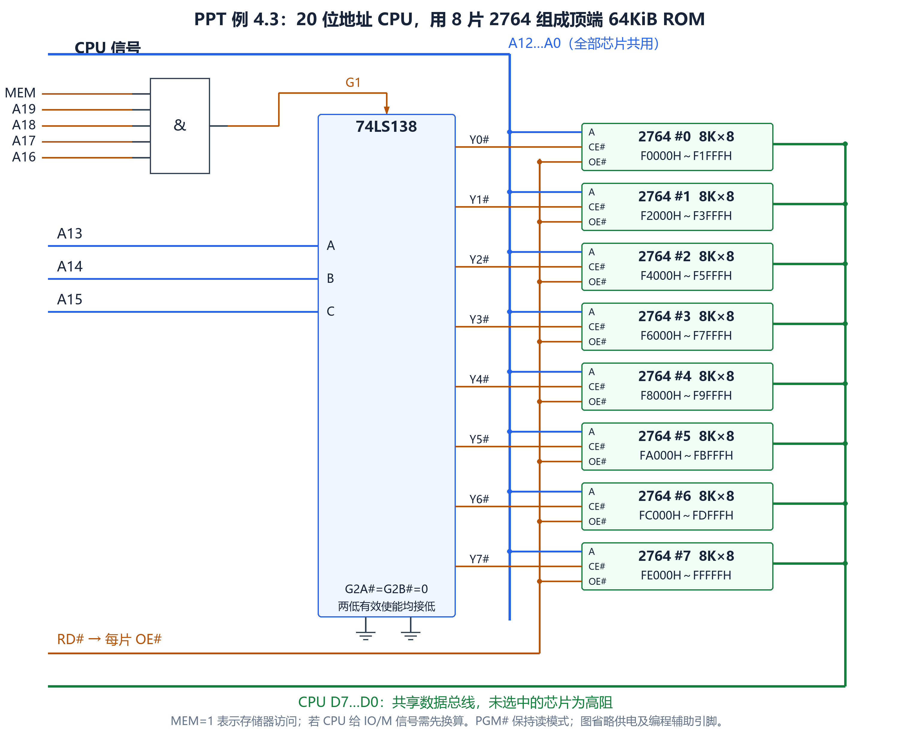

图中统一用 `MEM=1` 表示访存。若题目的 `IO/M` 在访存时为 0，应先取反形成 MEM；要根据题目给定的极性判断，不能仅靠名称猜测。

1. `A19…A16=1111` 才属于 `FxxxxH` 区域，与 MEM 共同控制 138 的使能。
2. `(C,B,A)=(A15,A14,A13)`，译成 8 个低有效片选，分别接每片的 `CE#`。
3. `A12…A0` 同时接每片的 13 根地址线。
4. 每片的 `D7…D0` 接共享数据总线，只有被选中且允许读出的芯片驱动总线。
5. `RD#` 接各片 `OE#`；`PGM#` 置于非编程状态。CPU 的普通写命令不作为 EPROM 的普通 RAM 写入端使用。

| 138输出 | 芯片 | 地址范围 |
| --- | --- | --- |
| Y0# | ROM0 | F0000H–F1FFFH |
| Y1# | ROM1 | F2000H–F3FFFH |
| Y2# | ROM2 | F4000H–F5FFFH |
| Y3# | ROM3 | F6000H–F7FFFH |
| Y4# | ROM4 | F8000H–F9FFFH |
| Y5# | ROM5 | FA000H–FBFFFH |
| Y6# | ROM6 | FC000H–FDFFFH |
| Y7# | ROM7 | FE000H–FFFFFH |

每一片覆盖 $2000_H$ 个字节。片选还必须检查 A19…A16；若只看 A15…A13，就会在其他高位地址区域产生镜像，无法唯一限定在 F0000H–FFFFFH。

#### 教材补充：16 位数据总线的奇、偶存储体

教材例 4.3（书页 97–99）把字节编址的存储器分成两个 8 位体，支持按字节或 16 位字访问。

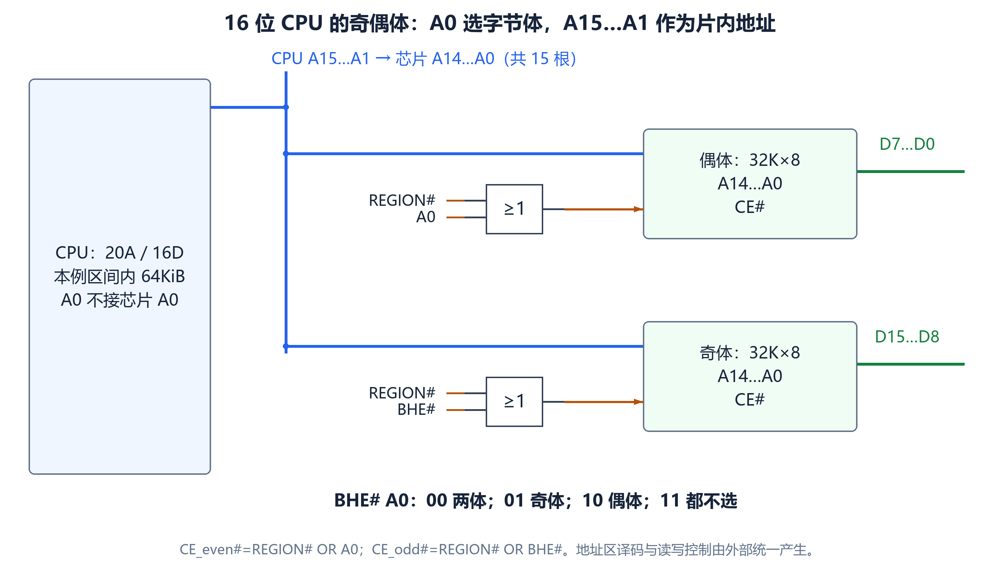

偶体接 `D7…D0`，奇体接 `D15…D8`；CPU 的 `A15…A1` 接两片 `32K×8 位` 芯片的 `A14…A0`。**A0 用于选字节体，不能再原样当作两片的片内最低地址。**

| BHE# | A0 | 本次访问 |
| --- | --- | --- |
| 0 | 0 | 两体同时选中，得到一个对齐的 16 位字 |
| 0 | 1 | 奇地址字节体 |
| 1 | 0 | 偶地址字节体 |
| 1 | 1 | 两体均不选中 |

若 `REGION#` 是低有效的区域选择，逻辑式为：$CE_{\text{偶}}\#=REGION\#\lor A_0$，$CE_{\text{奇}}\#=REGION\#\lor BHE\#$。这里两个独立的“字节使能”与“片内地址”分工，是理解双字节宽度系统的关键。

### 4.2.6 存储器的校验：用汉明码定位一位错

#### 检错与纠错为什么需要冗余位

最小码距 $L$ 是任意两个**合法码字**之间至少有多少位不同。合法码字相隔越远，越容易发现或定位错误。

- 要保证检测 $d$ 位错误，需要 $L\ge d+1$。
- 要保证纠正 $c$ 位错误，需要 $L\ge2c+1$。
- 教材将同时纠正至多 $C$ 位、并检测更多错误的条件写为 $L\ge D+C+1$，其中 $D\ge C$。

普通汉明码的典型最小距离为 3，可在**至多一位错误**的假设下定位并纠正。只做检测时能检出两位错误；若还要可靠区分“一位错可纠正”和“两位错不可纠正”，通常再加总奇偶位形成 SECDED，不能把普通 7 位汉明码的一个非零校验结果一律当作单错。

#### 编码：4 位数据 0101 怎样变成 7 位

对应书页 100–102、PPT 第 78–83 页。设数据 $n$ 位，增加 $k$ 位检测位：

$$
2^k\ge n+k+1
$$

理由是 $k$ 位检测结果要区分 $n+k$ 个可能的单错位置，再加 1 个“未检出错误”状态。$n=4$ 时，$k=2$ 不够，$k=3$ 时 $8\ge8$，故增加 3 位。

本笔记沿教材**从左到右编号为 1…7**。检测位放在 $1、2、4$，数据顺序填入 $3、5、6、7$：

| 位置 | 1 | 2 | 3 | 4 | 5 | 6 | 7 |
| --- | --- | --- | --- | --- | --- | --- | --- |
| 内容 | C1 | C2 | 数据0 | C4 | 数据1 | 数据0 | 数据1 |

一个位置应参加哪些组，由**位置编号的二进制表示**决定：如位置 6 为 `110`，属于 C4、C2 组，不属于 C1 组。

| 检测位 | 检测组 | 偶校验时计算 |
| --- | --- | --- |
| C1 | 1、3、5、7 | $h_3\oplus h_5\oplus h_7=0\oplus1\oplus1=0$ |
| C2 | 2、3、6、7 | $h_3\oplus h_6\oplus h_7=0\oplus0\oplus1=1$ |
| C4 | 4、5、6、7 | $h_5\oplus h_6\oplus h_7=1\oplus0\oplus1=0$ |

所以结果为 `0 1 0 0 1 0 1`，即 **0100101**。其中 $\oplus$ 是异或：两位不同时为 1，相同时为 0。

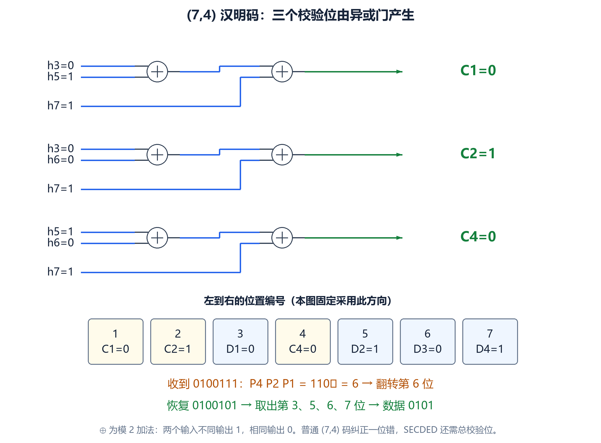

图中每个圆圈加号是一个两输入异或门，多个异或门串联可以统计一组输入中 1 的个数是否为奇数。偶校验组的全部位再异或，正确时结果为 0。

#### 纠错：收到 0100111 时怎么恢复

$$
P_1=h_1\oplus h_3\oplus h_5\oplus h_7=0
$$

$$
P_2=h_2\oplus h_3\oplus h_6\oplus h_7=1
$$

$$
P_4=h_4\oplus h_5\oplus h_6\oplus h_7=1
$$

按权重由高到低组合为 $P_4P_2P_1=110_2=6$，在单错假设下第 6 位出错，翻转该位后回到 `0100101`，取第 3、5、6、7 位，得到数据 **0101**。

`000` 表示这一校验没有检出错误；不能对任意多位错误都保证无漏检。若检测位本身出错，数据位可能仍正确；为恢复一个完整、可继续使用的码字，仍可修正该检测位。课件“检测位可不纠”是在只取本次有效数据的语境下说的。

### 4.2.7 提高访存速度：变快、变宽与重叠访问

可以缩短器件存取周期、增加一次读写的位数、让多个存储体重叠工作，或使用 Cache。要说明具体是哪一种改善，不能只写“增加芯片就更快”。

#### 单体多字

教材图 4.41（书页 103）、PPT 第 85 页：一次从同一个存储体取出连续多个字，先保存在宽数据寄存器，再逐字送给 CPU。以单体四字为例，每次取 $4W$ 位。

收益依赖访问连续性。若频繁跳转或操作数分散，预先取出的其他字可能用不上。它增加每周期取得的信息量，没有直接缩短单元的物理读出时间。

#### 高位交叉、低位交叉怎样分地址

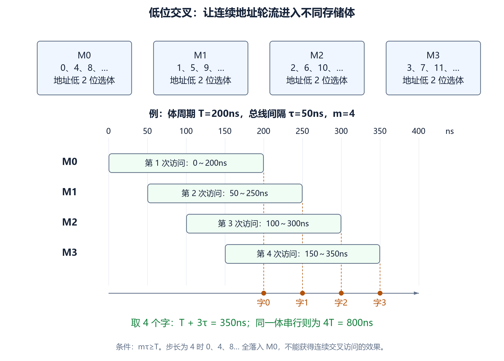

对应教材图 4.42–4.45（书页 104–106）、PPT 第 86–91 页。

| 方式 | 体号来自哪里 | 连续地址放在哪里 | 适合怎样理解 |
| --- | --- | --- | --- |
| 高位交叉 | 地址高位 | 同一个体内先连续存放，满了再到下一个体 | 不同请求可访问不同体；连续数据可能集中于同一体 |
| 低位交叉 | 地址低位 | 按体 0、1、2、3 轮流存放 | 连续请求可以依次启动不同体，重叠执行 |

设四体低位交叉，访问地址按**字地址**计：

$$
\text{体号}=A\bmod4,\qquad\text{体内地址}=\lfloor A/4\rfloor
$$

例：地址 13，体号 $13\bmod4=1$，体内地址 $\lfloor13/4\rfloor=3$。各体分别包含 `0,4,8,…`、`1,5,9,…`、`2,6,10,…`、`3,7,11,…`。

#### 低位交叉为什么能提高带宽

设每体存取周期为 $T$，共享总线每 $\tau$ 可传一个字，存储体有 $m$ 个。为了轮回到同一体时，它已经能再次工作，需要：

$$
m\tau\ge T,\qquad m\ge\left\lceil T/\tau\right\rceil
$$

课件四体示例取 $T=4\tau$，是刚好衔接的情况；一般条件是足够覆盖 $T$。在地址落到不同体、每隔 $\tau$ 启动一次等理想条件下，连续取 $n$ 个字：

$$
t_{\text{低位交叉}}=T+(n-1)\tau
$$

第一份数据要等一个 $T$，后面每隔 $\tau$ 出一份。单体周期并没有变短。

**教材例 4.6**：4 体，32 位／字，$T=200$ ns，$\tau=50$ ns，连续取 4 个字：

$$
t_{\text{同体顺序访问}}=4T=800\text{ ns},\qquad t_{\text{交叉}}=200+3\times50=350\text{ ns}
$$

信息量为 $4\times4=16$ B，所以带宽分别是 **20 MB/s** 与约 **45.71 MB/s**。长连续流进入稳态后，理想输出速率可接近 $4\text{ B}/50\text{ ns}=80\text{ MB/s}$；短序列的首份等待不能忽略。

> [!note] 低位交叉的条件
> 若步长恰好为 4 字，地址 `0、4、8、12` 都落在体 0，仍会发生体冲突。多体结构提供并行的机会，实际收益还依赖地址分布、总线和控制器。

#### 存控与高性能存储芯片

教材书页 106–109、PPT 第 92–93 页：多个请求源可能同时访问存储器，存控通过排队器、标记触发器、节拍发生器和控制线路协调。教材示例优先保证容易丢失的信息，再考虑严重影响 CPU 执行的请求；这是给定模型的调度规则。

SDRAM 通过公共时钟、命令与延迟约定组织访问，也可采用多体与突发传送；RDRAM 是教材介绍的另一种提高带宽的接口方案；带 Cache 的 DRAM 在芯片内用 SRAM 暂存一行，利用连续列访问。

**同步不等于零延迟**。SDRAM 接到命令后仍有内部操作时间；若 CPU 有独立工作可做，可以在等待数据时继续做那些工作，依赖该数据的操作仍要等结果。课件“CPU 无须等待”要结合这个条件理解。

## 4.3 高速缓冲存储器 Cache

### 4.3.1 概述：为什么小容量高速存储器能起作用

#### 局部性与按块调入

对应书页 109–114、PPT 第 94–102 页。

**时间局部性**：刚访问过的信息，近期可能再次访问，例如循环体、重复使用的变量。**空间局部性**：刚访问的地址附近，近期可能被访问，例如连续指令与数组。

因此，CPU 虽然面对很大的主存空间，但一段时间内往往反复使用其中的一小部分。Cache 用 SRAM 保存这些主存块，在命中时让 CPU 快速取数。

| 交换关系 | 本章基本模型中的传送单位 |
| --- | --- |
| CPU 与 Cache | 按 CPU 所需的字／数据访问 |
| Cache 与主存 | 整个块（Cache 行）调入或写回 |

**一次访问一个字，并不意味着只把这一个字调入 Cache。** 块内邻近的字一起带入，才能利用空间局部性。Cache 与主存的对应块大小相同。

每行除数据外，还需要标记 Tag 和有效位 V；写回方式还需要脏位 D。题目给出“Cache 容量”时通常指**数据容量**，计算存储阵列总位数时，才按要求另加标记、有效位、脏位和其他控制信息。

#### 命中率、平均访问时间与效率

设命中次数 $N_h$，未命中次数 $N_m$：

$$
h=\frac{N_h}{N_h+N_m},\qquad\text{未命中率}=1-h
$$

教材与 PPT 使用的简化路径计时模型为：命中一次用 $t_c$，未命中整次用 $t_m$，不另加一次 Cache 检查时间：

$$
t_{\text{avg}}=h t_c+(1-h)t_m,\qquad e=\frac{t_c}{t_{\text{avg}}}\times100\%
$$

**PPT 第 7 页例题**：$t_c=0.01\ \mu s=10$ ns，$t_m=0.1\ \mu s=100$ ns，$h=0.95$：

$$
t_{\text{avg}}=0.95\times10+0.05\times100=9.5+5=14.5\text{ ns}
$$

如果另一道题规定“先查 Cache，未命中后**额外**访问主存”，额外未命中代价为 $p$，应使用：

$$
t_{\text{avg}}=t_c+(1-h)p
$$

同样给出 10 ns 和额外代价 100 ns 时，结果是 $10+0.05\times100=15$ ns。**先确认未命中的时间是否已包含查 Cache 的时间，不能把两个公式混用。**

访问速度与时间成反比。若没有 Cache 时每次用 $t_m$：

$$
\text{性能变为原来的倍数}=\frac{t_m}{t_{\text{avg}}}
$$

“变为原来的 $S$ 倍”与“提高了 $S-1$ 倍”要区分。

> [!warning] 核对教材例 4.10（书页 121–122）
> 教材给 $h=95\%$、主存时间为 Cache 的 5 倍，却把 $0.95t+0.05\times5t$ 写成 $1.5t$。正确结果为 **$1.2t$**。
>
> 因而性能应变为原来的 $5/1.2\approx4.17$ 倍，即提高约 3.17 倍。不要将该例的算术笔误当作另一套公式。

#### 读与写：谁需要更新主存

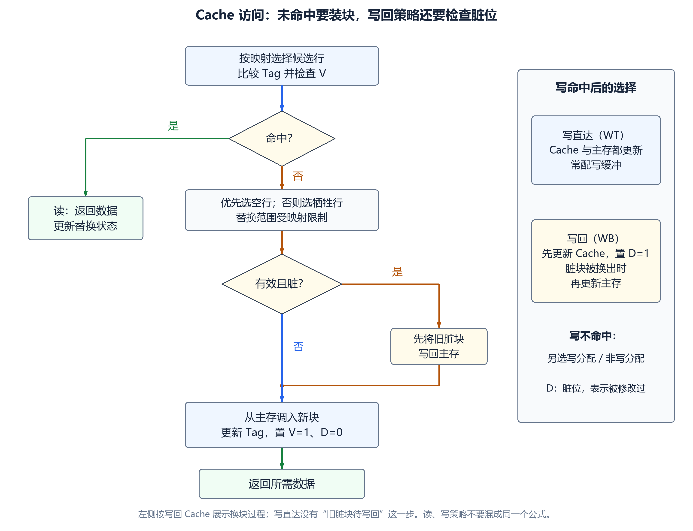

读命中直接返回数据；读未命中时，**先在该地址允许的位置中寻找无效行或选择牺牲行**，必要时写回脏块，再调入新主存块，更新 Tag、V 等状态，并完成 CPU 请求。直接映射只允许一个候选位置；组相联只在指定组内选位置，所以不能只看“整个 Cache 是否已满”。

| 写策略 | 写命中时 | 替换该行时 | 状态需求 |
| --- | --- | --- | --- |
| 写直达 Write-through | 更新 Cache，同时把更新交给主存路径 | 数据已提交主存，不需要因该行被改写再写回整块 | 控制较直接，主存写流量较多 |
| 写回 Write-back | 只更新 Cache，并把该行标为脏 | **仅脏行**需要写回，干净行可直接丢弃 | 需要脏位和写回控制 |

写未命中时，还要规定是否先把块装入 Cache，即“写分配／不写分配”。它与“写直达／写回”分别讨论装不装块、更新何处；题目没有给定时不要自行假定所有写失效都走同一条路。

教材图示与文字主要按单 CPU 的 Cache–主存关系解释。多 CPU 各有 Cache 时，即使主存已更新，另一颗 CPU 的旧副本仍可能过期，还需一致性机制；此处不展开协议。

#### Cache 的改进

多级 Cache 让靠近 CPU 的层级更快、后级提供更多容量；分立的指令 Cache 与数据 Cache 让取指和取数有更独立的通路，减少争用。课件列举的处理器容量和工艺是历史示例，本章要掌握组织方式与作用。

### 4.3.2 Cache–主存地址映射

#### 块号、行号、标记分别是什么

按字节编址，设地址为 $A$、每块有 $B$ 字节：

$$
j=\lfloor A/B\rfloor\quad\text{（主存块号）},\qquad d=A\bmod B\quad\text{（块内字节偏移）}
$$

设 Cache 有 $L$ 行，每组 $k$ 路，则有 $S=L/k$ 组。这里用 L 表示行数，避免与容量 C 混淆；教材也常用 C 表示缓存块数。

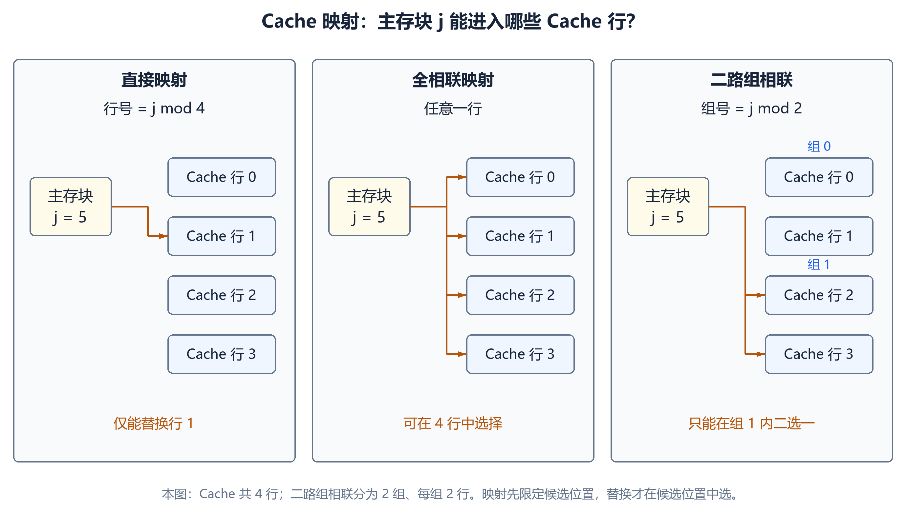

| 映射 | 主存块 j 可以放哪里 | 怎样判断命中 | 替换范围 |
| --- | --- | --- | --- |
| 直接映射 | 唯一行 $i=j\bmod L$ | 选中该行后比较 Tag 与 V | 唯一行，无需多候选替换算法 |
| 全相联 | 任意一行 | 各行 Tag 并行比较，并检查 V | 全 Cache |
| k 路组相联 | 第 $s=j\bmod S$ 组内任意一路 | 比较指定组的 k 路 Tag 与 V | 指定组 |

组相联的“组号固定、组内位置灵活”分别体现了直接映射与全相联的特点。一路组相联等效直接映射；只有一组且所有行都在组内时，等效全相联。

**小例子：Cache 共 4 行，访问主存块 `0、4、0、4`。** 直接映射都只能放第 0 行，产生连续冲突；二路组相联有两组，块 0 和 4 都映射到第 0 组，但可以占两路，因此前两次装入后，后两次可以命中。图 17 用 4 行展示这种差别。

#### 命中判断电路：行号只能找到候选，不能证明命中

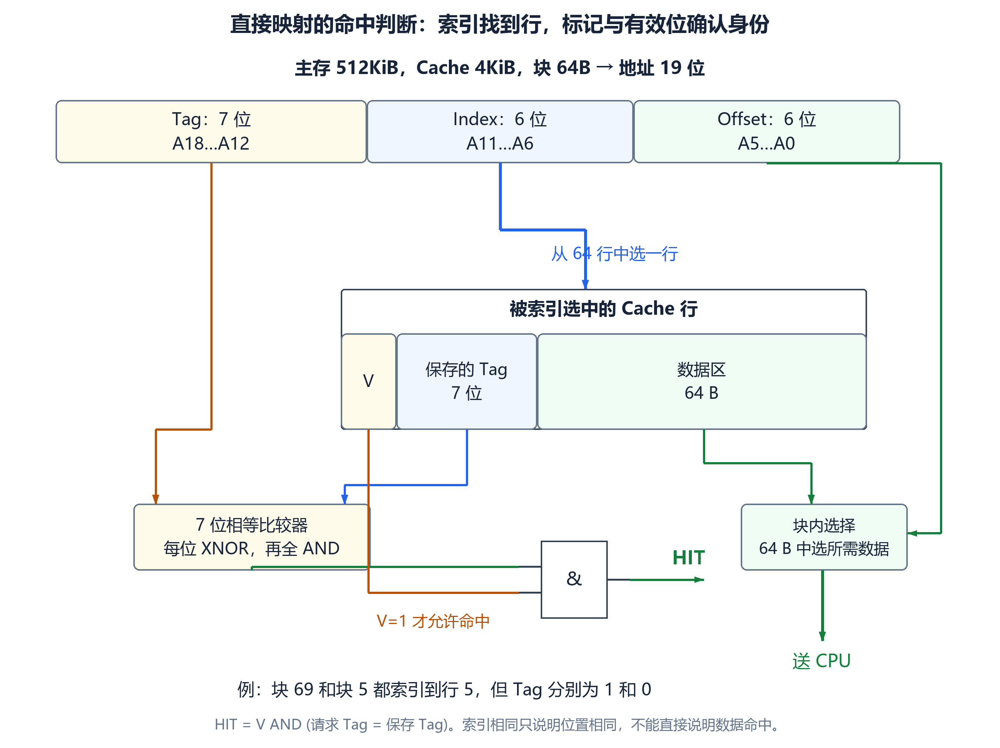

图 18 对应教材图 4.54（书页 117–118），采用下面例 4.8 的参数：主存 512 KiB，Cache 数据容量 4 KiB，每块 64 B，直接映射。

1. 中间的 6 位 Index 送给 Cache 行译码，选中 64 行中的一行。
2. 从该行取出已保存的 Tag 和有效位 V。
3. 输入地址的 7 位 Tag 与保存的 7 位 Tag 比较。比较可理解为**逐位同或，再把各位相等结果相与**。
4. 只有 `Tag相同 AND V=1` 才命中；再由低 6 位偏移定位块内所需数据。

$$
HIT=V\land\bigwedge_i\overline{(Tag_{\text{输入},i}\oplus Tag_{\text{保存},i})}
$$

例如主存块 69 与块 5 都对应 Cache 行 5，但它们的 Tag 分别为 1 与 0。Index 相同仅表示候选行相同；Tag 与 V 才说明候选行是否装着这次要找的块。

全相联把类似比较电路扩展到各行；组相联在指定组内比较各路。附录 4A（书页 153–155）介绍“相联／按内容寻址”：用并行比较寻找内容匹配者，电路成本也随比较规模增大。

#### 地址字段的通用算法

设完整地址有 $a$ 位，块内可编址单位数为 $B$，组数为 $S$，且均为 2 的幂：

$$
b=\log_2 B,\qquad s=\log_2 S,\qquad t=a-s-b
$$

地址分为 **Tag（t 位）／组或行 Index（s 位）／Offset（b 位）**。

> [!important] B 的单位必须跟编址单位相同
> 字节编址时，块内偏移统计字节数；字编址时，统计字数。例如 16 个 32 位字，在字节编址下是 $16\times4=64$ B，偏移 6 位；在 32 位字编址下是 16 个字，偏移 4 位。

#### 教材例 4.8：完整算一遍

书页 120：主存 512 KiB、Cache 数据容量 4 KiB，每块 16 个 32 位字，按字节编址。

**第一步，块大小**：$16\times(32/8)=64\text{ B}=2^6\text{ B}$，所以 Offset 为 6 位。

**第二步，完整地址长度**：$512\text{ KiB}=2^{19}\text{ B}$，主存字节地址为 19 位。

**第三步，Cache 行数**：$4\text{ KiB}/64\text{ B}=2^{12}/2^6=64$ 行。

**第四步，按映射方式拆字段**：

| 映射 | 组／行数 | Tag 位数 | Index 位数 | Offset 位数 | 合计 |
| --- | --- | --- | --- | --- | --- |
| 直接 | 64 行 | $19-6-6=7$ | 6 | 6 | 19 |
| 二路组相联 | 32 组 | $19-5-6=8$ | 5 | 6 | 19 |
| 全相联 | 1 组、64 路 | $19-0-6=13$ | 0 | 6 | 19 |

做映射取模时，本笔记统一从 **块号 0** 开始。教材例 4.8 的第（3）问另规定“第 1 块为起始”，则要先用编号减 1 转成从 0 开始的块号，算完再加 1，不能混用两种编号。

### 4.3.3 替换策略

| 算法 | 选谁被替换 | 命中后怎样影响顺序 |
| --- | --- | --- |
| FIFO | 最早进入该候选集合的块 | 命中通常不改变进入先后 |
| LRU | **距上次访问时间最久**的块 | 命中会更新最近使用顺序 |
| 随机 | 在候选块中随机选 | 按给定策略实现 |

LRU 的判断依据是“上次何时用过”，不是累计使用次数。对一个只有两路的组，访问顺序 `A、B、A、C`：装入 A、B 后，第三次又用了 A；C 到来时，FIFO 换出最早装入的 A，LRU 换出更久未使用的 B。

组相联只在目标组内替换；直接映射的目标位置已经唯一确定。不要因为另一组有空位，就把块装到不允许的组里。

## 4.4 辅助存储器

### 4.4.1 概述：大容量后援与速度指标

辅存保存大量暂不参与 CPU 当前运算的信息，教材主要介绍磁盘、磁带和光盘。程序所需内容通常要先通过 I/O 系统调入主存，才供 CPU 按主存访问方式使用。

| 指标 | 含义 |
| --- | --- |
| 道密度 | 沿半径方向单位长度的磁道数，是道间距的倒数 |
| 位密度 | 一条磁道单位长度能记录的二进制位数 |
| 容量 | 有效盘面、磁道、扇区及扇区数据量共同决定 |
| 平均寻址时间 | 平均寻道时间 + 平均旋转等待时间 |
| 数据传输率 | 找到数据后，每秒传多少位／字节 |
| 误码率 | 读出错误位数／读出总位数 |

在教材“各磁道容量相同”的简化模型中，内圈周长较短，位密度较高。遇到另有分区记录等条件的题目，应按题目给定的各区域参数计算。

### 4.4.2 磁记录原理和编码波形

#### 磁头怎样写入与读出

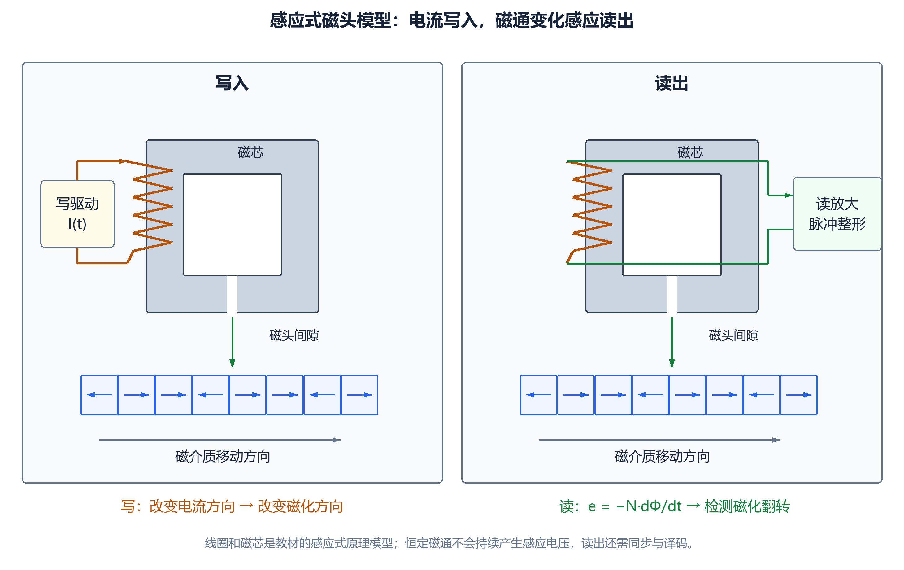

对应教材图 4.61–4.62（书页 125–126）、PPT 第 108–109 页。图中是教材的**感应式磁头模型**：写线圈中的驱动电流产生磁场，把运动中的介质局部磁化；电流方向改变，可形成不同方向的剩磁。

读出时，介质与磁头相对运动，磁通变化在读线圈中产生感应电势：

$$
e=-N\frac{d\Phi}{dt}
$$

因此要关注磁化方向**在哪些时刻发生翻转**。原始读出信号还需放大、整形，并结合时钟／同步信号，才能恢复位序列。

#### 六种记录方式：先判断翻转规则，再画电流波形

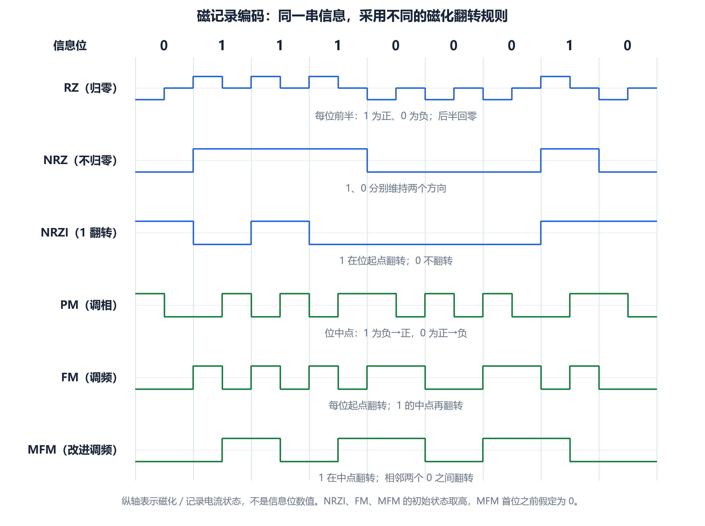

对应教材图 4.63（书页 127–128）、PPT 第 110 页。配图采用课件的序列 `0 1 1 1 0 0 0 1 0`；每个方格代表一个位周期，图中规则和初始状态写在图下。

| 方式 | 一位内部怎样表示 | 位边界怎样处理 |
| --- | --- | --- |
| RZ（归零） | 1 为正脉冲、0 为负脉冲，随后回零 | 每位之间电流回到 0 |
| NRZ（不归零） | 1 为正电流、0 为负电流 | 代码改变才翻转 |
| NRZI（见1就翻） | 1 触发一次翻转，0 保持 | 本图把翻转放在该位起始处 |
| PM／PE（调相） | 位中间必翻转；1 从负到正，0 从正到负 | 必要时在位边界调整，形成下一个位的相位 |
| FM（调频） | 1 在位中间再翻转，0 位中间不翻转 | 每个位起始都翻转 |
| MFM（改进调频） | 1 在位中间翻转 | 当前位与前一位均为 0 时，当前位起始翻转 |

PM／FM／MFM 能利用读出翻转信号提取同步信息；NRZ／NRZI 在某些长串数据下可能很久没有翻转，难以仅靠这一路信号保持位同步。MFM 通过减少不必要的翻转，在给定最小翻转间隔等条件下提高记录密度。

画 NRZI 时要先指定初始电流方向；画 MFM 的第一个位时要说明前一位的状态。起始极性不同可能使整个波形上下翻转，但判定位值仍须遵守同一套编码规则。

### 4.4.3 硬磁盘：几何组织、寻址与计算

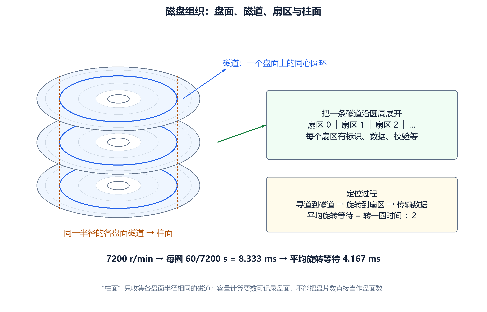

对应书页 129–137、PPT 第 112–115 页。

- **盘面**：一张盘片可以有两个表面，但题目可能规定部分表面不能记录。
- **磁道**：一个盘面上半径相同的一圈记录路径。
- **柱面**：多个记录面上半径相同的磁道组成的集合，换磁头可访问同一柱面的不同面。
- **扇区／扇段**：把每条磁道划成的记录区段；教材定长记录格式按扇段定位数据。

在经典 CHS 模型里，地址包含磁道／柱面号、盘面／磁头号、扇区号；若有多台设备，还含台号。磁盘控制器把主机的命令与数据格式转换为驱动器可执行的读写、定位等操作。

#### 容量按层数相乘

设有效记录面数为 $H$，每面磁道数为 $C$，每道扇区数为 $S$，每扇区有效数据为 $b$ B：

$$
\text{格式化数据容量}=H\times C\times S\times b\quad(\text{B})
$$

先数**有效盘面**，不能直接把盘片数当作记录面数。若 6 张盘片的最外两面不记录，则共有 $6\times2-2=10$ 个记录面。

**教材例 4.12（书页 135–136）**：10 个记录面，每面 204 道，每道 12 扇段，每扇段 512 B：

$$
C=10\times204\times12\times512=12\,533\,760\text{ B}\approx11.953\text{ MiB}
$$

若给的是“每道总位数”，则先按记录面×磁道×每道位数得到 bit，再根据需要除以 8。格式、间隙、地址与校验字段也占用物理空间，不要把未格式化容量与有效数据容量当成同一个量。

#### 转速怎样变成旋转等待时间

转速为 $r$ 转／分，则一圈时间为：

$$
T_{\text{一圈}}=60/r\quad\text{s}
$$

假设目标角位置均匀分布，平均要等半圈：

$$
t_{\text{平均等待}}=30/r\quad\text{s}
$$

例：7200 r/min，一圈 $60/7200=8.333$ ms，平均等待 **4.167 ms**。若平均寻道 8 ms，平均寻址时间为 $8+4.167=12.167$ ms。若问一次完整读写，还应按条件加上数据传输时间及控制等开销。

若每道有 $S$ 个等长扇区、无额外开销，读一个扇区的转动时间约为 $T_{\text{一圈}}/S$；连续数据的理想传输率可按“每道数据量 × 每秒转数”求出。它与找到起点之前的寻址延迟是不同指标。

#### 固定磁头、移动磁头、阵列

固定磁头模型对各磁道配置磁头，省去径向寻道；移动磁头通过驱动与位置反馈把磁头移到目标磁道。课件中“目标磁道—位置检测—驱动”构成闭环控制，目标与实际位置的偏差用于调整移动。

PPT 第 115 页列出 RAID0、RAID1、RAID5。帮助识别名称的补充如下，容量按同容量磁盘、忽略元数据计算：

| 名称 | 组织思想 | 典型容量与容错 |
| --- | --- | --- |
| RAID0 | 数据分条带放到多盘 | N 块容量 D 的盘可用约 ND，无冗余容错 |
| RAID1 | 保存镜像副本 | 两盘镜像可用约 D，可承受其中一盘故障 |
| RAID5 | 分布式校验条带 | N 块盘可用约 $(N-1)D$，可承受一盘故障 |

本章把阵列作为组织多盘改善性能／可靠性的思路，不由盘数直接推出所有访问都严格快 N 倍。

### 4.4.4 软磁盘与 4.4.5 磁带

| 介质 | 本章的访问与结构特点 | 复习时关注 |
| --- | --- | --- |
| 软盘 | 可换盘片、磁头接触介质，按磁道扇区读写 | 记录格式、写保护、FM/MFM、格式化容量 |
| 磁带 | 文件沿带长顺序存放，访问远处要走带 | 顺序访问、数据块与块间隙、后备存储 |

教材磁带一节（书页 142–144）比 PPT 讲得更完整：数据流磁带可持续记录，各道首尾交替的方式称蛇形记录。块间空白有助于记录区分及机械启停缓冲；校验可结合横向奇偶、纵向校验与 CRC。掌握这些结构原因即可，教材列出的历史尺寸与容量用于理解当时的设备，不当作今天设备的统一参数。

### 4.4.6 CRC：异或运算如何形成校验码

#### 模2运算与编码步骤

对应书页 144–147、PPT 第 118–121 页。模2加、减都是按位异或，**不进位、不借位**：$1\oplus1=0$，$1\oplus0=1$。

设数据为 $M(x)$，生成多项式 $G(x)$ 的最高次数为 $r$，即 G 有 $r+1$ 位：

1. 数据末尾补 $r$ 个 0，得到 $M(x)x^r$。
2. 用 G 做模2长除，取不足 r 位时补齐为 r 位的余数 R。
3. 把 R 拼到原数据后，形成 $C(x)=M(x)x^r\oplus R(x)$。

由于模2运算中 $R\oplus R=0$，形成的码字可被 G 整除。接收端再除以 G，余数非零说明检出了错误；余数为零只表示**没有检出错误**，并不保证任意错误都被排除。

#### 教材例 4.15：1100 用 1011 编码

$$
G=1011=x^3+x+1,\quad r=3,\quad M=1100
$$

数据补零：`1100 → 1100000`。用对齐异或展示除法：

```text
1100000
1011000    最高位为1，异或对齐后的1011
-------
0111000
0101100    再对齐最高位的1
-------
0010100
0010110
-------
0000010    余数取低3位：010
```

所以 CRC 码为 **1100 010 = 1100010**，共 7 位、有效信息 4 位，称为 (7,4) 码。再用 `1100010 ÷ 1011` 做模2除，余数为 `000`。

#### 异或门与移位寄存器实现除法

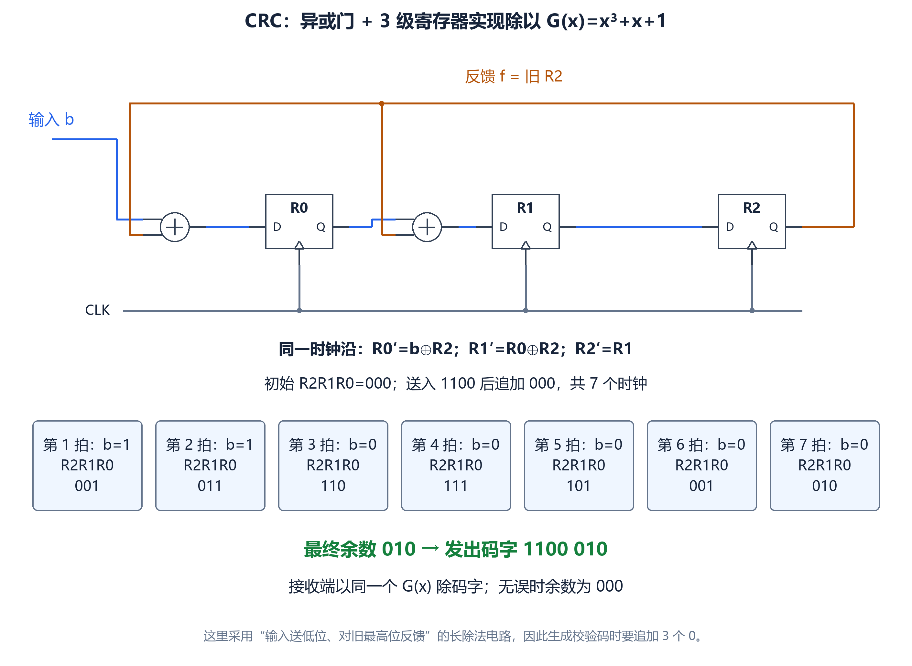

图是为上面长除法补画的硬件等效电路。3 个 D 触发器保存当前余数的 3 位；最高位 R2 反馈到系数为 1 的位置，异或门实现减去多项式中的 $x$ 与常数项。所有寄存器在同一个时钟边沿更新。

本图采用**输入位移入最低位**的约定，初值全 0。每拍的同时更新关系为：

$$
R_2^{\text{新}}=R_1,\qquad R_1^{\text{新}}=R_0\oplus R_2,\qquad R_0^{\text{新}}=\text{输入位}\oplus R_2
$$

向此图依次输入 `1100000`（数据后含 3 个补零），完成 7 拍后，$R_2R_1R_0=010$。该过程把“移位”和“模2减”变成了触发器与异或门的动作。不同结构的 CRC 电路可能把补零步骤隐含在反馈方式中，必须连同该图的输入约定一起使用。

#### CRC 的纠错能力有条件

教材表 4.6 对这个 **长度为 7、G=1011、且至多单错**的例子，列出余数与错误位置的对应关系：

| 余数 | 000 | 001 | 010 | 100 | 011 | 110 | 111 | 101 |
| --- | --- | --- | --- | --- | --- | --- | --- | --- |
| 解释 | 未检出错误 | 第7位错 | 第6位错 | 第5位错 | 第4位错 | 第3位错 | 第2位错 | 第1位错 |

这里从左到右编号 1…7，**不能把余数直接当作错误位号**。它不同于前面汉明码 $P_4P_2P_1$ 的二进制定位方式。

一般 CRC 的检错、纠错范围取决于生成多项式、码长和错误模型。多位错误可能产生与单错相同的余数，也可能恰好漏检，不能仅凭某个非零余数对任意错误随意翻转一位。

### 4.4.7 光盘

教材书页 147–150、PPT 第 122 页，把光盘分为只读型、一次写入多次读取型（WORM）和可擦写型。只读／一次写入型通过介质的反射差异等保存信息；可擦写型可采用热磁或相变等机制。读取依靠激光与光电检测。

对比时抓住：磁盘用磁性状态和磁头系统；光盘用光学读出；磁带沿带长顺序寻找记录。具体速度、介质寿命和容量随产品与技术条件变化，不把旧教材中的市场数字当成通用定值。

## 复习与自测

### 电路题与计算题的检查顺序

**看电路**：① 明确有效电平；② 找到选片、选行、选列的条件；③ 顺着数据通路说明读／写；④ 检查未选中输出是否隔离；⑤ 最后看建立、保持与恢复时间。

**算容量与连接**：① 编址单位；② 字数与字长；③ 两个扩展倍数；④ 低位片内地址与高位片选；⑤ 每片起止地址；⑥ 访存控制与读写控制。

**算 Cache**：① 把容量与块长统一单位；② 完整地址位数；③ Cache 行数与组数；④ Offset、Index、Tag；⑤ 逐次判断命中／替换；⑥ 说明平均时间的计时口径。

### 18 道自测，点开查看答案

> [!question]- 1. 24 位字节地址能寻址多少容量？若每个字 32 位，共多少个字？
> $2^{24}$ B = **16 MiB**；每字 4 B，共 $2^{24}/4=2^{22}$，即 **4 M 个字**。若题目另规定 24 位独立字地址，则容量是 $2^{24}\times4=64$ MiB，条件已改变。

> [!question]- 2. 不复用地址的 8K×8 位芯片，地址线、数据线各多少？容量多大？
> 地址线 $\log_2 8192=13$ 根，数据线 8 根；容量 **8 KiB**。13+8=21 根只统计地址、数据，不包含控制与电源引脚。

> [!question]- 3. 32×32 重合法阵列为什么只有 64 条译码选择线，却能选择 1024 位？
> 行选择线 32 条，列选择线 32 条，合计 64；行列的组合是 $32\times32=1024$。完整地址仍需 $5+5=10$ 位。

> [!question]- 4. 教材 SRAM 图画了 T1…T8，为什么仍称六管基本单元？
> T1…T6 构成一个保存一位的单元；T7/T8 是一列共用的外围列选择管。正常读出通过反馈继续维持原状态。

> [!question]- 5. CS#=1 时，WE#=1 是否一定读出数据？Z 是什么？
> 不会。芯片没有被选中，数据输出为高阻态 Z。Z 表示不驱动共享线路；与输出逻辑 0 不同。

> [!question]- 6. 128 行 DRAM，2 ms 内刷完，每行耗时 0.5 μs。集中刷新多久？异步逐行间隔多长？
> 集中占用 $128\times0.5=\mathbf{64\ \mu s}$，死时间率 $64/2000=\mathbf{3.2\%}$。异步逐行间隔至多 $2000/128=\mathbf{15.625\ \mu s}$，单次仍占用 0.5 μs。

> [!question]- 7. 用 1K×4 位组成 4K×8 位，要几片？一次选中几片？地址线多少？
> 共 $(4K/1K)\times(8/4)=\mathbf8$ 片；每组两片拼成 8 位，一次选中一组，即 **2 片**。总地址需 12 位；低 10 位接片内，高 2 位译码选 4 组。

> [!question]- 8. 74138 的 Y5#=0 表示一个 2K 区域，若只取其中 A10=0 的 1K，低有效片选怎样接？
> $CS\#=Y5\#\lor A_{10}$。只有两个输入都为 0，输出才为低。教材带输入、输出反相圆圈的与门与这个正逻辑或门等价。

> [!question]- 9. F0000H–FFFFFH 共多大？用 8K×8 位 EPROM 要几片？ROM2 对应什么范围？
> 共 $10000_H=\mathbf{64\ KiB}$，需要 **8 片**。从 ROM0 开始，ROM2 的范围为 **F4000H–F5FFFH**。片选须同时限制最高四位为 1111。

> [!question]- 10. 偶校验、按教材从左编号，收到 0100111，至多一位错，怎样定位并取出数据？
> $P_1=0,P_2=1,P_4=1$，$P_4P_2P_1=110_2=6$。翻转第 6 位得到 **0100101**，取 3、5、6、7 位得到 **0101**。

> [!question]- 11. 四体低位交叉中，字地址 13 落在哪里？为什么步长 4 可能没有流水收益？
> 体号 $13\bmod4=\mathbf1$，体内地址 $\lfloor13/4\rfloor=\mathbf3$。步长 4 的地址低两位不变，会反复访问同一个体。

> [!question]- 12. 主存 512 KiB、Cache 4 KiB、每块 16 个 32 位字，按字节编址，二路组相联的地址字段多少位？
> 块长 $16\times4=64$ B，Offset **6 位**；完整地址 **19 位**；Cache 64 行，二路为 32 组，Index **5 位**；Tag $19-5-6=\mathbf8$ 位。

> [!question]- 13. 命中率 95%、命中 10 ns、未命中整次 100 ns，平均时间多少？若 100 ns 是额外失效代价呢？
> 前一种按路径加权：$0.95\times10+0.05\times100=\mathbf{14.5\ ns}$。后一种需先查 Cache，再多花失效代价：$10+0.05\times100=\mathbf{15\ ns}$。

> [!question]- 14. 两路同一组依次访问 A、B、A、C，FIFO 与 LRU 各换出谁？
> FIFO 换出最早装入的 **A**；LRU 因为第三次刚用过 A，换出更久未用的 **B**。前提是都映射到这一个组。

> [!question]- 15. CRC 数据 1100、G=1011，应补几位？余数与码字是什么？余数 110 是否就表示第 6 位错？
> G 的次数为 3，补 3 个 0。余数 **010**，码字 **1100010**。在这里长度 7、G=1011 的单错表中，余数 110 对应**第 3 位**；不要套用汉明码的二进制位号解释。

> [!question]- 16. 7200 转／分，平均寻道 8 ms，平均旋转等待与平均寻址各多久？
> 一圈 $60/7200=8.333$ ms；平均等半圈 **4.167 ms**；平均寻址 **12.167 ms**。如果问完成整个读取，还须按条件加数据传输等时间。

> [!question]- 17. 教材奇偶体结构中 BHE#=1、A0=0，访问哪一体？CPU 的 A1 应接芯片哪根地址线？
> 访问**偶字节体**，使用低 8 位数据总线。CPU 的 A1 接芯片 A0，因为 CPU 的 A0 已用于区分奇偶字节体。

> [!question]- 18. 初态空的 Cache，每块含 8 个字，从块边界开始连续读 100 个字并重复 10 遍；所有块都放得下且无替换冲突，命中率多少？
> 共访问 1000 次。第一次顺序读需要调入 $\lceil100/8\rceil=13$ 块，有 **13 次冷失效**，其余命中；后 9 遍全部命中。故 $h=(1000-13)/1000=\mathbf{98.7\%}$。这是教材例 4.11 的计数思路。

### 对照教材习题练习

教材习题跨书页 150–153，下表是练习路线，不需要一次全做。

| 练习目标 | 教材题号 | 回看内容 |
| --- | --- | --- |
| 分类、层次、时间、带宽、编址 | 4.1–4.6 | 4.1、4.2.1 |
| 芯片数量、SRAM/DRAM、译码与刷新 | 4.7–4.14 | 4.2.2–4.2.5 |
| CPU 连线、片选、地址线／片选故障 | 4.15–4.16 | 4.2.5 的连接步骤与两个例子 |
| 汉明码编码与纠错 | 4.17–4.21 | 4.2.6 |
| 多体访问与流水时间 | 4.22–4.24 | 4.2.7 |
| 局部性、Cache 字段、命中率和时间 | 4.25–4.33 | 4.3 |
| 磁记录波形、磁盘容量与地址 | 4.34–4.40 | 4.4.1–4.4.3 |
| CRC、光盘与介质比较 | 4.41–4.44 | 4.4.6–4.4.7 |

### 最容易混淆的概念

| 概念对 | 分辨依据 |
| --- | --- |
| 位数／字节数／字数 | 先明确每字有多少 bit、每地址对应多少 B |
| 存取时间／存取周期 | 本次何时有结果／最早何时再启动下一次 |
| 完整地址位数／地址引脚数 | DRAM 复用引脚时，一个完整地址分时送入 |
| 片选／行列选择 | 哪颗芯片工作／芯片内部选哪个位置 |
| 读后再生／定时刷新 | 修复本次读出的单元状态／避免未被访问单元漏电丢失 |
| 位扩展／字扩展 | 增加每次的数据宽度／增加可编址单元数量 |
| 字节编址／大端小端 | 一个地址覆盖多大空间／字节在地址中的排列 |
| 低位交叉／单元变快 | 多体操作重叠提高吞吐／器件访问本身变短 |
| Cache 放置／替换／写策略 | 允许放哪儿／候选满了换谁／写入更新哪里 |
| Index 相同／命中 | 找到候选行／Tag 匹配且有效 |
| 汉明综合校验结果／CRC 余数 | 前者在单错条件下可直接组成位号／后者需按码长和 G 查对应关系 |
| 寻址时间／传输时间 | 找到数据起点前／开始连续传数据后 |

## 配图与来源索引

学习材料：[[课件/04.pptx|04.pptx]]，122 页；唐朔飞《计算机组成原理》第二版第四章及附录 4A。教材原文件：`D:\WHUT\计算机组成与系统结构\计算机组成原理第二版-唐朔飞.pdf`。

| 配图 | 对应原材料 | 解释重点 |
| --- | --- | --- |
| 01–02 | 教材图 4.2–4.5，书页 71–73；PPT 5–9 | 层次、CPU–主存读写 |
| 03 | 图 4.9–4.10，书页 76；PPT 17–20 | 二进制译码与行列重合 |
| 04 | 图 4.11，书页 77；PPT 21–23 | 六管 SRAM、列开关和读写通路 |
| 05–06 | 图 4.13–4.16，书页 78–80；PPT 24–44 | 2114 的 4 位选择、读写时序 |
| 07–08 | 图 4.17–4.23，书页 80–85；PPT 45–59 | 三管／单管 DRAM、地址复用 |
| 09 | 图 4.27–4.30，书页 88–90；PPT 64–67 | ROM、PROM、浮栅的物理机制 |
| 10–12 | 图 4.32–4.35，书页 92–93；PPT 68–70 | 位、字、字位扩展 |
| 13 | 图 4.36–4.37，书页 94–96；PPT 72–74 | 74138、低有效逻辑与地址区域 |
| 14 | PPT 76；结合教材 4.2.5 的连接方法 | 20 位地址、8 位数据的 2764 连接题 |
| 15 | 书页 100–103；PPT 78–83 | 根据奇偶式补画异或门电路 |
| 16 | 图 4.42–4.45，书页 104–106；PPT 86–91 | 四体地址分配与访问重叠 |
| 17–19 | 图 4.51、4.54–4.56，书页 113–119；PPT 100–106 | 映射、命中逻辑、读写和脏块 |
| 20 | 图 4.65、4.70，书页 130、135；PPT 112–115 | 磁道、扇区、柱面 |
| 21 | 图 4.63，书页 127–128；PPT 110 | 六种编码的电流翻转 |
| 22 | 教材例 4.15，书页 145–146；PPT 118–121 | 按多项式推导补画移位异或实现 |
| 23 | 图 4.61–4.62，书页 125–126；PPT 108–109 | 感应式磁头写入与读出 |
| 24 | 图 4.39–4.40，书页 98–99 | 奇偶体、字节使能与片内地址 |

全部配图为据原材料重画或为公式补画的教学图。电路端口名中的 `#` 用于明确低有效；图中颜色用于区分数据、地址、控制或存储状态，不代替逻辑高低。矩阵只画代表性行列，省略号表示同类电路重复。

**补充核对资料**：138 译码器的输入与输出极性参考 [TI 官方功能表](https://www.ti.com/lit/ds/symlink/sn74hc138.pdf)；浮栅存储结构参考 [Microchip 官方技术说明](https://www.microchip.com/en-us/products/memory/serial-and-parallel-flash/what-is-superflash-technology)。涉及教材或课件简化条件、算术笔误和题号差异的地方，已在相邻正文说明。

上一章的地址／数据／控制总线基础见 [[第3章 系统总线（图解学习笔记）|第3章系统总线笔记]]。
